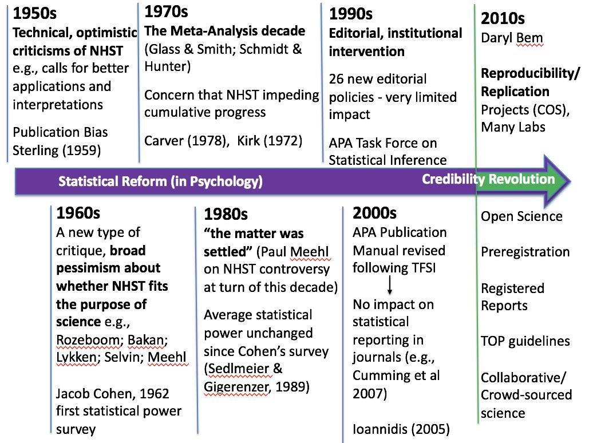
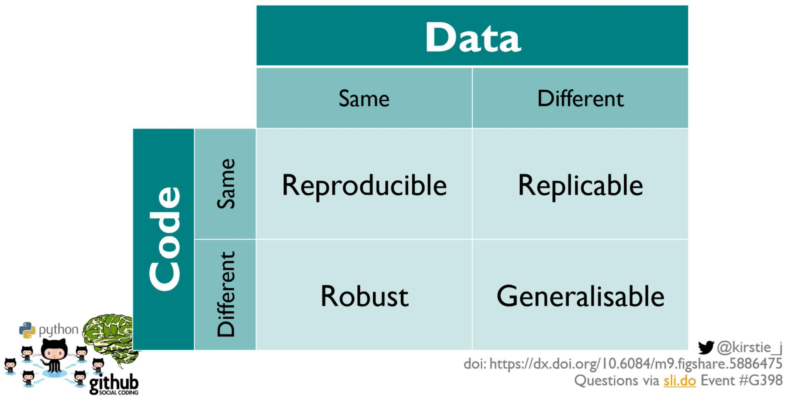

## AGENDA {.agenda-slide}
<!-- Klasse: .agenda-slide -->

1. *Replication Crisis* dan Mengapa *Reproducibility* Penting
2. *Data Management Plan*
3. Pra-registrasi
4. *Literate Programming*
5. *Registered Reports*
6. Kesimpulan

## {.section-slide}
<!-- Zwischentitelfolie 01 -->

::: {.section-number}
01
:::

::: {.section-bubble}
*Replication Crisis* dan Mengapa *Reproducibility* Penting
:::

## Mari Kita Mulai dengan Sebuah *Thought Experiment*

::: {.lead}
Anda membaca sebuah temuan menarik di suatu jurnal top dan membayangkan *paper* ini akan menjadi landasan fundamental dari disertasi Anda.
:::

::: {.incremental}

- **Pertanyaan 1:** Jika tim lain mencoba ulang *studi yang sama dengan mengambil data baru*, apakah mereka akan menemukan hasil yang sama?
- **Pertanyaan 2:** Jika Anda mengambil *data asli dan script analisis asli* dari penelitian tersebut, apakah Anda akan mendapatkan hasil yang sama persis seperti yang dilaporkan dalam paper tersebut?
- Secara intuitif, kita berasumsi jawaban untuk keduanya adalah "*ya, tentu saja! Paper ini, kan, sudah dipublikasikan di jurnal top Q1!*"
- Selama 15 tahun terakhir, para peneliti benar-benar mengeceknya. Jawabannya... **akan membuat Anda kaget**.

:::

## Bagaimana Masalah Ini Bermula (awal 2010-an)

::: {.incremental}

- **2011 — *Paper* "prekognisi" Bem**: sebuah jurnal top (Journal of Personality and Social Psychology - JPSP) mempublikasikan bukti bahwa orang bisa *merasakan apa yang akan terjadi di masa depan* ([Bem, 2011](https://psycnet.apa.org/record/2011-01894-001)) dengan menggunakan metode eksperimen dan menguji hipotesisnya dengan tes statistik standar. Jika sebuah eksperimen perilaku bisa "membuktikan" hal yang mustahil, lalu apa implikasinya bagi metode tersebut?
- [**2011 — Kasus kecurangan akademik Stapel**](https://www.nytimes.com/2013/04/28/magazine/diederik-stapels-audacious-academic-fraud.html): seorang profesor psikologi sosial terkemuka terbukti memalsukan data di puluhan paper yang sudah dipublikasikan.
- **2011 — "False-Positive Psychology"** ([Simmons, Nelson, & Simonsohn](https://journals.sagepub.com/doi/10.1177/0956797611417632)): menunjukkan bahwa pilihan-pilihan analitis yang kesannya remeh, biasa, tetapi tidak diungkapkan bisa membuat *apa pun* menjadi signifikan secara statistik. Di *paper* ini, mereka menunjukkan betapa "mudahnya" membuktikan bahwa mendengarkan sebuah lagu yang spesifik ("*When I'm 64*") membuat orang menjadi lebih muda.
- Peristiwa-peristiwa ini memicu pertanyaan besar: **seberapa banyak klaim ilmiah di literatur Psikologi yang benar-benar bisa kita percaya?**

:::

## Awal mula masalahnya sebenarnya sudah muncul lebih lama

{fig-align="center"}

## Studi-studi *multisite replications*

::: {.lead}
Tim-tim riset besar secara sistematis mencoba ulang studi-studi yang sudah dipublikasikan dengan data baru, dan inilah hasilnya:
:::

::: {.infographic}
::: {.infographic-cols}
::: {.infographic-item}
[36%]{.stat}

dari 100 studi psikologi yang dicoba ulang — [Open Science Collaboration (2015)](https://www.science.org/doi/10.1126/science.aac4716)
:::
::: {.infographic-item}
[61%]{.stat}

dari 18 eksperimen laboratorium ekonomi yang dicoba ulang — [Camerer et al. (2016)](https://www.science.org/doi/10.1126/science.aaf0918)
:::
::: {.infographic-item}
[62%]{.stat}

dari 21 studi ilmu sosial dari *Nature* & *Science* yang dicoba ulang — [Camerer et al. (2018)](https://www.nature.com/articles/s41562-018-0399-z)
:::
::: {.infographic-item}
[49%]{.stat}

dari 164 paper di 12 disiplin ilmu yang dicoba ulang dalam proyek **SCORE** ([Nature, April 2026](https://www.cos.io/about/news/large-scale-collaboration-releases-new-findings-on-research-credibility))
:::
:::
:::

- Bahkan ketika efeknya berhasil dicoba ulang, rata-rata *effect size*nya **hanya sekitar setengah** dari yang dilaporkan pada awalnya (dikenal sebagai "[The Decline Effect](https://www.frontiersin.org/journals/psychology/articles/10.3389/fpsyg.2019.02874/full)") — SCORE menemukan pola yang sama lagi pada 2026.
- **SCORE adalah riset reka ulang terbesar sejauh ini**: 865 peneliti menilai 3.900 paper (2009–2018, 62 jurnal, mencakup ekonomi, psikologi, ilmu politik, sosiologi, dan lainnya). Mereka ulang analisis yang sudah dipublikasikan pada data *asli* hanya berhasil [54% dari keseluruhan kasus](https://www.nature.com/articles/s41586-026-10203-5).
- Pola ini, yang muncul di psikologi, ekonomi, dan bidang-bidang lainnya, dan kini terkonfirmasi dalam skala besar, bahwa apa yang disebut media sebagai **"[replication crisis](https://www.nature.com/articles/d41586-026-00955-5)"** memang benar-benar terjadi.

## Tiga Istilah yang Sering Tertukar {.columns-slide}

::: {.lead}
Berdasarkan [Barba (2018)](https://arxiv.org/abs/1802.03311) dan [The Turing Way](https://book.the-turing-way.org/), kebanyakan orang sering mencampuradukkan istilah-istilah ini:
:::

::: {.columns-area}
::: {.col-item}
[<i class="fa-solid fa-rotate-right"></i>]{.col-icon}

### Reproducibility (🇮🇩 "*reka ulang*")

**Data sama + analisis sama → hasil sama.** Orang lain (atau diri Anda sendiri di masa depan) menjalankan ulang analisis *Anda* pada data milik *Anda* dan mendapatkan angka-angka yang sama seperti di *paper* Anda.
:::
::: {.col-item}
[<i class="fa-solid fa-people-group"></i>]{.col-icon}

### Replicability (🇮🇩 "*coba ulang*")

**Data baru + metode sama → hasil serupa.** Tim independen mengulang studi tersebut dengan partisipan baru dan menemukan *effect size* yang sebanding dengan penelitian aslinya.
:::
::: {.col-item}
[<i class="fa-solid fa-lightbulb"></i>]{.col-icon}

### Robustness (🇮🇩 "*keandalan*")

**Data sama + analisis baru → hasil sama, atau setidaknya kesimpulan yang serupa.** Temuan tetap stabil meskipun menggunakan strategi analitis yang berbeda.
:::
:::

## Lihat Perbedaannya Lebih Jelas

{fig-align="center"}

## Yang Lebih Mencemaskan

::: {.lead}
Mari kita lupakan sejenak soal mengumpulkan data baru (atau replikasi). Bisakah kita bahkan mereka ulang *hasil penelitian* dari *data aslinya*? (atau *reproducibility*)
:::

::: {.incremental}

- [Hardwicke et al. (2018)](https://royalsocietypublishing.org/doi/10.1098/rsos.180448) mencoba mereka ulang hasil dari *paper-paper* yang terbit di jurnal dengan kebijakan yang mewajibkan *data terbuka* di jurnal *Cognition*: hanya 11 dari 35 *paper* yang berhasil direka ulang tanpa bantuan dari penulis aslinya.
- [Artner et al. (2021)](https://psycnet.apa.org/record/2020-81352-001) hanya bisa mereproduksi ~70% klaim statistik utama dari artikel-artikel psikologi yang sudah dipublikasikan, dan sebagian di antaranya baru berhasil setelah melakukan kerja ala detektif yang cukup berat.
- [Crüwell et al. (2023)](https://journals.sagepub.com/doi/10.1177/09567976221140828) mengecek *badge* "*open data*" di *Psychological Science*: hanya 1 dari 14 artikel yang dinilai sepenuhnya *computationally reproducible*.
- Dan ini langsung berdampak pada kehidupan banyak orang: *flagship paper* tentang kebijakan *austerity* **Reinhart & Rogoff** yang sangat terkenal, yang banyak digunakan untuk membenarkan kebijakan ekonomi di banyak negara, ternyata mengandung **kesalahan di *file* Excelnya** yang amat sepele, dan baru ditemukan ketika seorang mahasiswa pascasarjana mendapatkan *spreadsheet*-nya ([Herndon et al., 2014](https://academic.oup.com/cje/article/38/2/257/1714018)).

:::

## Mengapa Ini Bisa Terjadi?

::: {.lead}
Ini sebagian besar bukan soal kecurangan yang benar-benar mengandung niat jahat, melainkan perilaku manusia yang sekadar mengikuti insentif. 
:::

::: {.incremental}

- ***Publication bias***: jurnal lebih menyukai temuan yang baru, positif, dan "bersih". Karena itu, hasil negatif/*null* sering kali berakhir di laci arsip (*file drawer*).
- ***Publish or perish***: karier akademik dibangun berdasarkan *jumlah* publikasi, bukan kualitas substantifnya.
- ***Questionable research practices* (QRPs)**: area abu-abu antara praktik baik dan kecurangan ([John et al., 2012](https://journals.sagepub.com/doi/10.1177/0956797611430953)):
  - ***p*-*hacking***: mencoba banyak analisis dan hanya melaporkan yang "berhasil"
  - **HARKing**: *Hypothesizing After the Results are Known* — menyajikan temuan eksploratif seolah-olah memang sudah diprediksi sebelumnya ([Kerr, 1998](https://journals.sagepub.com/doi/10.1207/s15327957pspr0203_4))
  - **Pelaporan selektif** (*selective reporting*) terhadap ukuran, kondisi, atau hasil
- ***The garden of forking paths***: bahkan tanpa niat buruk sekalipun, setiap dataset memungkinkan pilihan analisis yang sangat banyak dan sama-sama bisa dipertahankan, sehingga fleksibilitas dalam pilihan analitis bisa meningkatkan *false positive rate* ([Gelman & Loken, 2014](http://www.stat.columbia.edu/~gelman/research/unpublished/p_hacking.pdf)).

:::

## {.quote-slide}

::: {.quote-bubble}
> An article about computational science in a scientific publication is not the scholarship itself, it is merely advertising of the scholarship. The actual scholarship is the complete software development environment and the complete set of instructions which generated the figures.

::: {.quote-author}
Buckheit & Donoho (1995), memparafrasekan Jon Claerbout
:::
:::

## Mengapa *Anda* Perlu Peduli? {.text-slide-bg}

::: {.lead}
Memastikan hasil kita dapat direka ulang dapat memberi kita lebih banyak kepercayaan diri atas pekerjaan kita.
:::

::: {.content-box}
- **Kolaborator terdekat Anda adalah diri Anda sendiri, enam bulan yang lalu**, dan Anda-di-masa-lalu tidak dapat membalas chat WhatsApp. Alur kerja yang *reproducible* berarti Anda selalu bisa menelusuri kembali langkah-langkah Anda sendiri.
- **Kesalahan tertangkap lebih awal**, sebelum berakhir di disertasi Anda, ujian/sidang, atau bahkan *retraction*.
- ***Reviewer*, promotor, dan komite ujian semakin mengharapkannya**. Pendana dan jurnal kini rutin mensyaratkan peneliti untuk membagikan data dan material riset.
- **Membuat Anda lebih efisien**. Menjalankan ulang analisis setelah "tolong tambahkan satu variabel kontrol saja" hanya butuh satu klik.
- **Ini membangun kepercayaan terhadap pekerjaan Anda**. Riset yang *reproducible* akan lebih banyak digunakan ulang, disitasi, dan dikembangkan lebih lanjut.
:::

## "Tangga *Reproducibility*"🪜

::: {.lead}
Mulailah dengan tingkat transparansi **yang Anda butuhkan**, bukan yang **Anda inginkan**. Empat praktik dalam presentasi ini *bukan checklist* yang harus selesaikan semester ini, atau bahkan sepanjang program S3 Anda. Ini adalah tangga yang akan Anda daki selama bertahun-tahun sepanjang karier profesional Anda ke depan.
:::

::: {.incremental}
- **Anak tangga 1 — *Data Management Plan***: memiliki hambatan yang paling rendah, manfaat paling langsung. Sebuah *folder* yang bisa dijelajahi siapa pun, termasuk Anda di masa depan.
- **Anak tangga 2 — Pre-Registration**: sebuah disiplin perencanaan riset — menuliskan hipotesis sebelum Anda tahu jawabannya.
- **Anak tangga 3 — Literate Programming**: sebuah kebiasaan teknis — biarkan dokumennya sendiri yang menghitung, bukan Anda yang menyalin angka secara manual.
- **Anak tangga 4 — Registered Reports**: komitmen terbesar — *review* dilakukan sebelum hasil ada, berlangsung selama bertahun-tahun.
- Inilah urutan yang **saya alami** ketika mendaki tangga ini, selama kurang lebih 15 tahun perjalanan karier akademik saya. Saya akan tunjukkan seperti apa bentuknya masing-masing anak tangga ini dari sudut pandang saya.
:::

## {.section-slide}
<!-- Zwischentitelfolie 02 -->

::: {.section-number}
02
:::

::: {.section-bubble}
Data Management Plan
:::

## Apa Itu *Data Management Plan* (DMP)?

::: {.lead}
Sebuah dokumen singkat dan hidup (living document), yang ditulis **sebelum** Anda mengumpulkan data, yang menjelaskan bagaimana data akan dikumpulkan, didokumentasikan, disimpan, dilindungi, dan dibagikan.
:::

::: {.incremental}

- Anggap saja ini sebagai menjawab pertanyaan: *"Jika saya menghilang besok, bisakah orang lain menemukan, memahami, dan menggunakan data saya?"*
- Semakin **diwajibkan oleh *funder*** (DFG, ERC, NIH, dan banyak *funder* internasional lainnya) dan oleh komite etik.
- DMP memaksa munculnya pertanyaan yang tepat pada waktu yang tepat, *sebelum* masalah menjadi tidak bisa diperbaiki lagi (misalnya, formulir *informed consent* yang justru melarang data dibagikan).
- *Tools* gratis dengan *template* dan panduan: [DMPTool](https://dmptool.org) dan [DMPonline](https://dmponline.dcc.ac.uk).

:::

## Menanamkan Kebiasaan DMP ke dalam Proyek yang Sedang Berjalan

::: {.lead}
Saya sedang mengerjakan *scoping review* tentang praktik *reproducibility* di bidang ekonomi dan ilmu sosial, yang merupakan bagian dari proyek yang lebih besar tempat saya terlibat. Struktur *folder* kerjanya seperti ini:
:::

::: {.content-box}
```text
litsearch/
├── codes/                        R scripts
├── coding/                       Codebooks, coding sheets, dan Google Form/Sheet
├── dataset/                      Dataset siap analisis, hasil ekspor dari coding
├── output/
│   ├── search_output/            Output pipeline pencarian literatur (01–11)
│   ├── analysis_output/          Tabel dan gambar dari analisis
│   └── cleaning_log/             Flag kualitas data dari proses pembersihan respons
└── protocol_logbook.docx         Logbook protokol dan keputusan
```

- Setiap *file* juga diberi satu kalimat deskripsi — misalnya `10_final_set.xlsx`: *"The 145-paper final corpus... verified against Zotero subcollection RIS exports."* [Lihat README-nya di sini](libs/README.md).
- **Manfaat #1 — untuk diri saya di masa depan**: saya kembali ke *folder* ini setelah berbulan-bulan mengerjakan tugas lain, dan tetap tahu persis harus mencari ke mana.
- **Manfaat #2 — pembaca di masa depan**: ketika ini nanti menjadi *paper* yang dipublikasikan, *reviewer* dan pembaca bisa memverifikasi apa pun yang saya lakukan.
:::

## Apa Saja yang Termasuk dalam DMP? {.columns-slide}

::: {.columns-area}
::: {.col-item}
[<i class="fa-solid fa-file-lines"></i>]{.col-icon}

### *Documentation*

Data apa yang akan Anda kumpulkan dan bagaimana caranya? Format apa saja? Sebuah **kamus data (*codebook*)** yang mendeskripsikan setiap variabel (nama, redaksi pertanyaan, *coding*, *missing value*) agar data tetap bisa dipahami tanpa kehadiran Anda.
:::
::: {.col-item}
[<i class="fa-solid fa-shield-halved"></i>]{.col-icon}

### *Storage* & *Ethics*

Di mana data akan disimpan, bagaimana cara backup-nya ([aturan 3-2-1](https://en.wikipedia.org/wiki/Backup)), siapa yang punya akses? Bagaimana partisipan dilindungi, termasuk informed consent, anonimisasi atau pseudonimisasi, serta persyaratan hukum yang berlaku?
:::
::: {.col-item}
[<i class="fa-solid fa-share-nodes"></i>]{.col-icon}

### *Sharing* & *Preservation*

Data mana yang bisa dibagikan, di mana, [dengan lisensi apa](https://id.creativecommons.net/pilihan-lisensi-cc/), dan kapan? Apa yang diarsipkan dalam jangka panjang (biasanya 10 tahun) dan di repository tepercaya yang mana?
:::
:::

## Data FAIR

::: {.lead}
Standar acuan untuk data riset yang dibagikan ([Wilkinson et al., 2016](https://www.nature.com/articles/sdata201618)), data seharusnya **FAIR**:
:::

::: {.infographic}
::: {.infographic-cols}
::: {.infographic-item}
[F]{.stat}

***Findable*** — disimpan dengan pengenal permanen (DOI) dan metadata yang kaya
:::
::: {.infographic-item}
[A]{.stat}

***Accessible*** — dapat diambil lewat protokol standar; syarat aksesnya jelas
:::
::: {.infographic-item}
[I]{.stat}

***Interoperable*** — format terbuka (CSV, bukan hanya SPSS), menggunakan kosakata standar
:::
::: {.infographic-item}
[R]{.stat}

***Reusable*** — lisensi jelas, *provenance* (informasi tentang asal-usul data), dan dokumentasi yang cukup untuk digunakan ulang
:::
:::
:::

- Penting: **FAIR ≠ terbuka (*open*)**. Prinsipnya adalah *"seterbuka mungkin, setertutup yang diperlukan."* Data sensitif tetap bisa FAIR meskipun aksesnya dibatasi.

## Kebiasaan Praktis yang Gratis {.text-slide-bg}

::: {.content-box}
- **Penamaan *file***: mudah dibaca mesin, mudah dibaca manusia, mudah diurutkan — `2026-07-08_study1_raw.csv`, bukan `data baru FINAL (2).sav`. Tanpa spasi, tanpa karakter khusus, tanggal dalam format YYYY-MM-DD.
- **Data mentah adalah sesuatu yang sakral**: simpan sebagai `read-only`, di satu tempat; semua perubahan dilakukan lewat *script* ke `data/processed/`.
- **Tulis *codebook*-nya sambil Anda menyusun survei**.
- **Pilih *repository* untuk menyimpan data**: [OSF](https://osf.io), [Zenodo](https://zenodo.org), [PsychData](https://www.psychdata.de), [RIN Dataverse (BRIN)](https://data.brin.go.id/) — semuanya menyediakan DOI dan preservasi jangka panjang.
- [**Pilih lisensi**](https://www.imperial.ac.uk/research-and-innovation/support-for-staff/scholarly-communication/research-data-management/sharing-data/licensing-your-data/) agar orang lain tahu apa yang boleh mereka lakukan: misalnya, [CC0/CC-BY](https://id.creativecommons.net/pilihan-lisensi-cc/) untuk data dan materi, [MIT/GPL](https://www.credativ.de/en/blog/credativ-inside/understanding-open-source-licenses-gpl-mit-apache-compared/) untuk kode.
- **Rencanakan *consent* untuk berbagi data**: tambahkan bahasa terkait berbagi data ke *informed consent* Anda *sekarang juga*, karena Anda tidak bisa meminta izin secara retroaktif kepada 800 partisipan anonim.
:::

## {.section-slide}
<!-- Zwischentitelfolie 03 -->

::: {.section-number}
03
:::

::: {.section-bubble}
Pre-Registration
:::

## Masalah yang Diselesaikan oleh Pre-Registration

::: {.incremental}

- Ingat kembali ***garden of forking paths***: dengan fleksibilitas yang cukup, hasil signifikan hampir selalu bisa ditemukan.
- Statistik hanya bisa berfungsi dengan baik jika perbedaan antara dua mode riset ini diakui secara jujur:
  - Riset **konfirmatori**: hipotesis ditentukan *sebelum* melihat data → nilai *p* menjadi pengujian yang bermakna.
  - Riset **eksploratori**: pola ditemukan *di dalam* data → berguna untuk menghasilkan hipotesis, tetapi nilai *p* tidak lagi berarti seperti yang diklaim.
- Keduanya sama-sama boleh. Masalahnya adalah **menyajikan eksplorasi seolah-olah konfirmasi** (HARKing).
- **Pre-registration** mengembalikan perbedaan ini: Anda menuliskan hipotesis, desain, dan rencana analisis Anda **sebelum** pengumpulan data, dalam sebuah registry yang **diberi cap waktu (*time-stamped*) dan *read-only*** ([Nosek et al., 2018](https://www.pnas.org/doi/10.1073/pnas.1708274114)).

:::

## Dari Pekerjaan Saya Sendiri: Mengunci Hipotesis Sebelum Melihat Data

::: {.lead}
Salah satu contoh saya yang paling jelas: [*"Science and Religion in the Times of Crisis"*](https://osf.io/ctru2/overview), *pre-registered* di OSF.
:::

::: {.content-box}
- Studi ini menguji **"*dilution effect*"**: apakah menawarkan *lebih banyak* penjelasan atas suatu krisis justru mengurangi seberapa berguna setiap penjelasan itu terasa bagi orang ([Jackson et al., 2024](https://osf.io/ctru2/overview)).
- Saya menuliskan hipotesisnya, dalam sebuah catatan publik yang diberi cap waktu, **sebelum** saya tahu apakah datanya akan mendukungnya atau tidak.
- Ini sangat membantu saya merencanakan studi dengan lebih baik dan mempertahankan pilihan desain saya ketika mendiskusikannya dengan supervisor saya.
- Apa pun hasilnya nanti, saya tidak bisa begitu saja membingkai ulang studi ini seolah-olah "memang ini yang saya prediksi sejak awal." Cap waktu itu membuat hal itu mustahil, dan itu membantu saya tetap jujur pada diri saya sendiri.
- Saya sudah melakukan *pre-registration* untuk setiap studi yang saya jalankan sejak 2021.
  + Ini sekarang sudah menjadi bagian normal dari mendesain sebuah studi.
:::

## Apa Saja yang Termasuk dalam *Pre-Registration*? {.columns-slide}

::: {.lead}
*Registry* gratis dengan template: [OSF Registries](https://osf.io/registries) dan [AsPredicted](https://aspredicted.org). Isi umumnya:
:::

::: {.columns-area}
::: {.col-item}
[<i class="fa-solid fa-clipboard-question"></i>]{.col-icon}

### *Hypotheses & Design*

Hipotesis terarah (directional), IV dan DV dengan operasionalisasi yang tepat, desain studi, kondisi, dan prosedur.
:::
::: {.col-item}
[<i class="fa-solid fa-users"></i>]{.col-icon}

### *Sample & Exclusions*

Target ukuran sampel **dengan justifikasi** (misalnya, power analysis), stopping rule, dan kriteria eksklusi.
:::
::: {.col-item}
[<i class="fa-solid fa-chart-line"></i>]{.col-icon}

### *Analysis Plan*

Model statistik yang pasti untuk setiap hipotesis, penanganan missing data dan outlier, kriteria inferensi, serta apa yang akan Anda lakukan jika asumsinya tidak terpenuhi.
:::
:::

## Kekhawatiran Umum (dan Mengapa Sebagian Besar Tidak Beralasan)

::: {.incremental}

- **"Ini seperti penjara — saya jadi tidak bisa fleksibel."** Bisa, kok! Penyimpangan itu wajar; Anda tinggal melaporkannya secara transparan ("kami menyimpang dari rencana karena..."). Registry hanya membuat penyimpangan itu menjadi *terlihat*.
- **"Ini membunuh eksplorasi."** Tidak. Anda tetap bisa bereksplorasi dengan bebas; hasilnya hanya diberi label sebagai eksploratif. Banyak *template* bahkan punya bagian khusus untuk analisis eksploratif yang sudah direncanakan.
- **"Nanti ide saya diserobot orang."** Registrasi bisa **diembargo** (dirahasiakan) sampai Anda mempublikasikannya.
- **"Ini menambah terlalu banyak pekerjaan administratif."** Registrasi [AsPredicted](https://aspredicted.org/) hanya berisi 9 pertanyaan. Dan sebagian besar isinya adalah teks yang tetap Anda butuhkan untuk pengajuan etik dan bagian metode Anda. Anda pada dasarnya hanya menulisnya *lebih awal*.
- **Catatan penting**: *pre-registration* bukan solusi instan. Banyak *pre-registration* yang masih tidak jelas, dan penyimpangan sering tidak dilaporkan ([van den Akker et al., 2024](https://psycnet.apa.org/fulltext/2025-33919-001.html)). Nilainya justru datang dari rencana yang *spesifik* dan pelaporan yang *transparan* yang merupakan sebuah keterampilan yang bisa Anda latih sejak studi pertama Anda.

:::

## {.section-slide}
<!-- Zwischentitelfolie 04 -->

::: {.section-number}
04
:::

::: {.section-bubble}
Literate Programming
:::

## Alur Kerja *Copy-Paste*

::: {.lead}
Alur kerja dalam riset psikologi biasanya seperti ini:
:::

::: {.incremental}

- Menjalankan analisis di SPSS dengan mengklik-klik menu...
- ...menyalin angka-angkanya ke dokumen Word secara manual...
- ...memformat tabelnya secara manual...
- ...lalu seorang *reviewer* meminta Anda mengeluarkan tiga partisipan, dan Anda harus **melakukan semuanya lagi dari awal**, sambil berharap Anda mengklik tombol-tombol yang persis sama.
- Setiap langkah manual adalah tempat kesalahan bisa menyelinap masuk, dan tidak ada seorang pun (termasuk Anda sendiri) yang bisa memverifikasi kembali apa yang sebenarnya sudah dilakukan.
- Kira-kira **separuh dari *paper* psikologi yang dipublikasikan mengandung setidaknya satu statistik yang tidak konsisten** — misalnya, nilai *p* yang tidak cocok dengan statistik ujinya sendiri ([Nuijten et al., 2016](https://link.springer.com/article/10.3758/s13428-015-0664-2)).

:::

## {.quote-slide}

::: {.quote-bubble}
> Let us change our traditional attitude to the construction of programs: Instead of imagining that our main task is to instruct a computer what to do, let us concentrate rather on explaining to human beings what we want a computer to do.

::: {.quote-author}
[Donald Knuth (1984), *Literate Programming*](https://academic.oup.com/comjnl/article-abstract/27/2/97/343244)
:::
:::

## *Literate Programming*: Satu Dokumen untuk Semuanya

::: {.lead}
**Idenya:** menganyam narasi teks, kode analisis, dan hasilnya (tabel, gambar, statistik) menjadi *satu* dokumen yang memperbarui dirinya sendiri.
:::

::: {.incremental}

- Anda menulis teks dan *script* secara bersamaan; satu klik ("*Render*") menjalankan semua perintah dan menghasilkan laporan jadi, sehingga angka, tabel, dan gambar **disisipkan secara otomatis**.
- Ubah datanya atau analisisnya → *render* ulang → **setiap angka dalam dokumen memperbarui dirinya sendiri**, tanpa perlu menyalin-tempel angka secara manual.
- Dokumennya sendiri *adalah* jejak audit: siapa pun bisa melihat persis kode mana yang menghasilkan hasil yang mana.
- **Fakta menarik**: ***slide* yang sedang Anda lihat ini** adalah hasil *literate programming*😉 Ini adalah dokumen Quarto yang di-*render* menjadi presentasi.

:::

## Contoh Dari Pekerjaan Saya Sendiri

::: {.lead}
Saya melakukan *pre-registration* dengan tekun selama bertahun-tahun sebelum saya belajar Quarto. *Literate programming* adalah anak tangga yang baru saya kuasai jauh *setelah* itu, dan pilihan ini mengubah cara saya menulis *paper*.
:::

::: {.content-box}
- Setiap *folder* proyek juga merupakan ***repository* [Git](https://id.wikipedia.org/wiki/Git)** — riwayat lengkap dari setiap perubahan, sehingga saya (atau seorang *reviewer*) bisa melihat persis bagaimana sebuah angka muncul.
- Dokumennya menarik angka langsung dari hasil analisis.
  + Saya berhenti mengetik hasil secara manual ke Word, yang justru merupakan langkah tempat kesalahan *copy-paste* dulu sering muncul.
- Contoh: [`grm-tutorial-paper`](https://github.com/rameliaz/grm-tutorial-paper), repository di balik [*paper* yang sudah dipublikasikan](https://onlinelibrary.wiley.com/doi/full/10.1002/ijop.13265) yang ditulis sepenuhnya sebagai dokumen *literate*.
- Bonus yang menyenangkan: editor dan *reviewer* berkomentar soal betapa *rapinya* proyek ini terlihat. Ini sebenarnya bukan tujuan utama dari *literate* programming, tapi tentu saja baik untuk reputasi Anda juga.
:::

## Alat-Alatnya {.columns-slide}

::: {.lead}
Semuanya gratis, semuanya *open source*, dan semuanya punya komunitas serta tutorial yang besar:
:::

::: {.columns-area}
::: {.col-item}
[<i class="fa-brands fa-r-project"></i>]{.col-icon}

### Quarto/R Markdown

Teks (Markdown) + potongan *script* R/Python → paper, *slide*, situs web, disertasi. Bersama **R** dan RStudio/Positron. [quarto.org](https://quarto.org)
:::
::: {.col-item}
[<i class="fa-brands fa-python"></i>]{.col-icon}

### Jupyter Notebooks

Notebook interaktif untuk Python (dan R, Julia). Umum digunakan dalam data science dan pemodelan komputasional. [jupyter.org](https://jupyter.org)
:::
::: {.col-item}
[<i class="fa-brands fa-git-alt"></i>]{.col-icon}

### Git & GitHub/OSF

Version control: riwayat lengkap dari setiap perubahan pada kode dan teks Anda, semacam "track changes" untuk seluruh proyek Anda, jadi tidak ada lagi `thesis_final_v7_REALLYFINAL.docx`.
:::
:::

## Seperti Apa Bentuknya

Alih-alih menyalin angka, Anda tinggal menulis:

```{{r}}
data <- read.csv(here::here("data", "processed", "study1.csv"))
model <- lm(wellbeing ~ social_media_use + age, data = data)
```

Dan di teks Anda, Anda menulis:

```markdown
Social media use was negatively associated with wellbeing,
b = `r round(coef(model)[2], 2)`.
```

- Ketika di-render, `` `r ` `` digantikan oleh **nilai aktual yang dihitung dari data**, sehingga selalu terkini dan tidak pernah salah ketik.
- *Package* seperti [`papaja`](https://github.com/crsh/papaja) dan [`apaquarto`](https://wjschne.github.io/apaquarto/writing.html) (manuskrip APA) serta [`apaTables`](https://dstanley4.github.io/apaTables/articles/apaTables.html) memformat seluruh bagian hasil untuk Anda secara otomatis.

## Melampaui Dokumen: Proyek yang *Reproducible* {.text-slide-bg}

::: {.lead}
*Literate programming* bekerja paling baik di dalam proyek yang terorganisasi dengan baik:
:::

::: {.content-box}
- **Satu folder per proyek**, dengan struktur standar: `data/raw/` (read-only!), `data/processed/`, `scripts/`, `output/`, `README.md`.
- ***Path* relatif**, jangan pernah pakai *path* absolut: `here::here("data", "raw", "survey.csv")`, bukan `C:/Users/amelia/Desktop/...` — sehingga bisa dijalankan di komputer *mana pun*, bukan hanya komputer Anda.
- **Atur *seed*** (`set.seed(42)`) setiap kali ada unsur keacakan (*randomness*), agar hasilnya identik setiap kali dijalankan.
- **Catat *environment* Anda**: versi *package* bisa berubah. *Tools* seperti `renv` (R) atau *virtual environment* (Python) menyimpan *snapshot* dari versi persis yang Anda gunakan.
- **Jangan pernah mengedit data mentah secara manual** — setiap langkah pembersihan data dilakukan lewat *script*, sehingga jejak dari data mentah ke tabel akhir terdokumentasi sepenuhnya.
:::

## *Computational Empathy*

::: {.lead}
Semangat di balik semua kebiasaan ini adalah apa yang disebut [The Turing Way](https://book.the-turing-way.org/reproducible-research/overview/overview-definitions) sebagai ***computational empathy***: mengantisipasi kebutuhan orang yang akan mencoba menjalankan pekerjaan Anda *tanpa Anda ada di ruangan*.
:::

::: {.incremental}

- Orang ini **tidak** memiliki struktur *folder* Anda, *package* yang Anda *install*, sistem operasi Anda, atau detail krusial yang hanya ada di kepala Anda ("*oh, kamu harus menjalankan script 2 dulu sebelum script 1*").
- Tanyakan pada diri Anda: *bisakah orang asing di komputer yang berbeda, tanpa kesempatan untuk mengirim email ke saya, sampai dari data mentah saya ke hasil saya?*
- Dalam praktiknya, *computational empathy* berarti:
  - sebuah [**README**](https://osf.io/uqyr3/files/2nd9w) yang menjelaskan apa proyek ini, apa yang ada di mana, dan **dalam urutan apa** menjalankan semuanya;
  - menyatakan **kebutuhan (*requirements*) di depan**: *software*, versi *package* (`renv`!), estimasi waktu *running script*nya;
  - **mmeberikan komentar "mengapa"-nya** dalam kode Anda;
  - menghindari dependensi tersembunyi — tanpa *path* absolut, tanpa "hapus baris 13 secara manual dulu," tanpa *file* yang hanya ada di desktop Anda.
- Uji yang paling disarankan: serahkan proyek Anda ke seorang kolega dan lihat mereka mencobanya. Setiap pertanyaan yang mereka ajukan adalah **potongan dokumentasi yang hilang**.
- Dan ingat: *orang asing* yang Anda perlakukan dengan baik ini biasanya adalah **diri Anda sendiri di masa depan**.

:::

## {.section-slide}
<!-- Zwischentitelfolie 05 -->

::: {.section-number}
05
:::

::: {.section-bubble}
Registered Reports
:::

## *Registered Reports*: *Pre-Registration* dengan Kekuatan Super

::: {.lead}
Sebuah ***Registered Report* (RR)** adalah format artikel jurnal di mana peer review terjadi **sebelum** hasilnya ada ([Chambers & Tzavella, 2022](https://www.nature.com/articles/s41562-021-01193-7)).
:::

::: {.incremental}

- **Stage 1**: Anda mengajukan pendahuluan, hipotesis, dan metode yang detail *sebelum* pengumpulan data. *Reviewer* mengkritisi desainnya **selagi Anda masih bisa memperbaikinya**.
- Jika diterima, Anda mendapatkan ***In-Principle Acceptance* (IPA)**: jurnal berkomitmen untuk mempublikasikan paper Anda **apa pun hasil yang keluar nanti**.
- **Stage 2**: Anda menjalankan studinya persis seperti yang sudah disetujui, mengajukan paper lengkap; *reviewer* hanya mengecek apakah Anda mengikuti rencana dan menginterpretasikan hasil secara masuk akal.
- Publikasi tidak lagi bergantung pada hasil yang "menarik" → ***publication bias* terpotong dari akarnya**, dan *p*-*hacking* kehilangan tujuannya.

:::

## Dari Pekerjaan Saya Sendiri: Anak Tangga yang Butuh 2,5 Tahun

::: {.lead}
Saya sekarang sudah menjadi bagian dari tiga *Registered Reports* yang sudah dipublikasikan. Ini adalah yang pertama kali saya menjadi penulis utama (*first author*), dan yang paling saya banggakan.
:::

::: {.content-box}
- Dari pertama kali merancang desainnya hingga *paper*-nya terbit: **sekitar dua setengah tahun**.
- Dipublikasikan sebagai [sebuah *Registered Report*](https://www.tandfonline.com/doi/abs/10.1080/10508619.2025.2535033); [*postprint*-nya tersedia *open-access* di PsyArXiv](https://osf.io/preprints/psyarxiv/bn6r4).
- Prosesnya lambat, dan pada beberapa titik terasa membuat frustrasi.
  + *Review Stage* 1 mendorong Anda untuk mendesain ulang sebelum Anda sempat mengumpulkan satu pun data.
  + Ini tidak nyaman, **dan justru di situlah letak seluruh manfaatnya**: saya memperbaiki masalah lebih awal di atas kertas, bukan ketika setelah menjalankan beberapa studi dengan ~300 partisipan.
- Saya tidak akan mencoba ini sebagai praktik *reproducibility* pertama saya. Ini baru masuk akal setelah *pre-registration* dan *literate programming* sudah menjadi kebiasaan rutin.
:::

## Apakah Ini Berhasil?

::: {.infographic}
::: {.infographic-cols}
::: {.infographic-item}
[96%]{.stat}

dari artikel psikologi standar melaporkan hasil **positif** (mengonfirmasi hipotesis) — sebuah tingkat keberhasilan yang secara statistik tidak masuk akal
:::
::: {.infographic-item}
[44%]{.stat}

dari *Registered Reports* melaporkan hasil positif ([Scheel, Schijen, & Lakens, 2021](https://journals.sagepub.com/doi/10.1177/25152459211007467))
:::
::: {.infographic-item}
[300+]{.stat}

jurnal kini menawarkan format RR, termasuk *Nature Human Behaviour*, *Cortex*, dan banyak jurnal psikologi top lainnya ([daftar COS](https://www.cos.io/initiatives/registered-reports))
:::
:::
:::

- RR juga dinilai **lebih cermat secara ilmiah (*rigorous*) dan berkualitas lebih tinggi** dibandingkan *paper* standar yang sebanding ([Soderberg et al., 2021](https://www.nature.com/articles/s41562-021-01142-4)).

## *Registered Reports* dan S3 Anda {.text-slide-bg}

::: {.content-box}
- **Masukan dari *reviewer* datang saat masih berguna**, sebelum Anda menghabiskan satu tahun untuk mengumpulkan data.
- **IPA adalah jaminan publikasi yang bisa Anda jadikan dasar merencanakan disertasi**: tidak perlu lagi berharap-harap cemas menunggu hasil publikasi sebelum ujian.
- **Hasil *null* menjadi temuan yang bisa dipublikasikan**, bukan tahun-tahun yang terbuang percuma dan *sekaligus* baik untuk CV Anda.
- Soal waktu: *review Stage* 1 memerlukan waktu, jadi RR cocok untuk studi yang direncanakan **jauh-jauh hari** (tetapi sempurna untuk proposal S3!), tapi kurang cocok untuk *pilot study* yang cepat.
- Beberapa jurnal menawarkan *fast-track* atau jadwal *review* khusus untuk proyek mahasiswa; **Peer Community In RR** ([PCI RR](https://rr.peercommunityin.org)) me*review* protokol Stage 1 secara independen dari jurnal mana pun.
- Bicarakan dengan promotor dan kopromotor Anda sejak dini: bab disertasi berbasis RR semakin umum dan sangat berharga bagi karier ilmiah seseorang.
  + Mungkin *belum* menjadi praktik umum di Unair, tapi ini semakin umum di banyak belahan dunia lain.
:::

## {.section-slide}
<!-- Zwischentitelfolie 06 -->

::: {.section-number}
06
:::

::: {.section-bubble}
Kesimpulan
:::

## Dari Mana Saya Memulai

::: {.lead}
Mulailah dengan transparansi **yang Anda butuhkan**, bukan yang **Anda inginkan**. Berikut urutan yang benar-benar saya daki:
:::

::: {.content-box}
1. ***Data Management Plan*** — hambatan paling rendah, hasil paling langsung. Saya mulai dari sini karena ini langsung membantu studi yang sedang saya jalankan *saat itu*.
2. ***Pre-registration*** — setelah mengorganisasi data menjadi rutinitas, merencanakan analisis di muka menjadi komitmen berikutnya yang wajar.
3. ***Literate programming*** — sebuah keterampilan teknis yang saya bangun setelah *pre-registration* membuat saya terbiasa berpikir dalam kerangka "rencana yang tertulis."
4. ***Registered Report*** — anak tangga tersulit, dan yang butuh 2,5 tahun. Saya tidak akan memulai dari sini.
- Semua ini terjadi selama kurang lebih 15 tahun, dimulai satu kebiasaan pada satu waktu.
:::

## Gambaran Besarnya

::: {.incremental}

- **Rencanakan (*Plan*)** → tulis ***data management plan***; lakukan *pre-registration* untuk hipotesis dan rencana analisis Anda atau langsung *all-in* dengan ***registered report***.
- **Kerjakan (*Do*)** → organisasikan proyek Anda dalam satu *folder*; jaga data mentah tetap *read-only*; analisis dengan ***literate programming*** agar setiap hasil bisa diperbarui dengan satu klik.
- **Bagikan (*Share*)** → simpan data (FAIR!), *script*, dan material riset di *repository* terpercaya dengan DOI dan lisensi; tautkan semuanya dari paper, dengan ***computational empathy*** yang cukup agar orang asing benar-benar bisa menjalankannya.
- Praktik-praktik ini hanya membutuhkan **kebiasaan**, dan kebiasaan paling mudah dibangun **sekarang**, di awal S3 Anda, sebelum Anda punya warisan masalah yang harus diurai.
- *Reproducibility* adalah sebuah **spektrum, bukan tes ya/tidak**: setiap langkah (sebuah *codebook* di sini, sebuah *script* di sana) sudah membuat pekerjaan Anda lebih bisa dipercaya dibandingkan kalau Anda tidak melakukan apa pun sama sekali.

:::

## Starter Kit Anda untuk Tahun Pertama {.columns-slide}

::: {.lead}
Langkah-langkah konkret pertama:
:::

::: {.columns-area}
::: {.col-item}
[<i class="fa-solid fa-1"></i>]{.col-icon}

### Minggu Ini

Buat akun [Zenodo](https://zenodo.org/) gratis. Siapkan proyek pertama Anda dengan struktur folder yang rapi dan sebuah README. Ganti nama *file-file* Anda dengan benar.
:::
::: {.col-item}
[<i class="fa-solid fa-2"></i>]{.col-icon}

### Bulan Ini

Pelajari cara menggunakan <i class="fa-brands fa-r-project"></i> dan [Quarto](https://quarto.org/docs/get-started/) atau R Markdown lewat tutorial yang tersedia ([Intro to <i class="fa-brands fa-r-project"></i>](https://kpuka.ca/resources/r_intro.html), [R4DS](https://r4ds.hadley.nz/), [Quarto TPG](https://quarto-tdg.org/)). Lalu, tulis tugas Anda berikutnya sebagai dokumen *literate*. Susun draf DMP satu halaman untuk proyek disertasi Anda.
:::
::: {.col-item}
[<i class="fa-solid fa-3"></i>]{.col-icon}

### Tahun Ini

Lakukan *pre-registration* untuk studi pertama Anda di OSF atau AsPredicted. Diskusikan dengan promotor Anda apakah salah satu bagian disertasi memungkinkan dijadikan *Registered Report*.
:::
:::

## Di Mana Bisa Belajar Lebih Lanjut {.text-slide-bg}

::: {.content-box}
- **[The Turing Way](https://book.the-turing-way.org)** — buku panduan gratis yang ditulis bersama komunitas tentang riset yang reproducible (mulai dari "Guide for Reproducible Research").
- **[FORRT](https://forrt.org)** — Framework for Open and Reproducible Research Training: glosarium, kumpulan sumber daya, dan ringkasan literatur-literatur kunci.
- **[Halaman dukungan OSF](https://help.osf.io)** — panduan praktis untuk proyek, registrasi, dan preprint.
- **[quarto.org](https://quarto.org)** — tutorial resmi untuk *literate programming* dengan R dan Python.
- Bacaan lanjutan: [Munafò et al. (2017), *A manifesto for reproducible science*](https://www.nature.com/articles/s41562-016-0021) — *paper overview* terbaik untuk memulai.
- Temukan **komunitas *open science*** lokal Anda (misalnya, [Sains Terbuka Airlangga](https://sainsterbukaua.github.io/)) — *reproducibility* jauh lebih mudah, dan lebih menyenangkan, jika dilakukan bersama-sama.
:::

## {.quote-slide}

::: {.quote-bubble}
> Your closest collaborator is you six months ago, but you don't reply to emails.

::: {.quote-author}
Mark Holder (dipopulerkan oleh Karl Broman) — permudah hidup diri Anda sendiri di masa depan.
:::
:::

## {.closing-slide .no-footer}

::: {.closing-left}
::: {.closing-contact-box}
**Dr. Rizqy Amelia Zein**\
Center for Advanced Internet Studies (CAIS) & Universitas Airlangga\
E-mail: [amelia.zein@cais-research.de](mailto:amelia.zein@cais-research.de) · Homepage: [rameliaz.github.io](https://rameliaz.github.io/)
:::

::: {.closing-cais-logo}

:::
:::

::: {.closing-right}
::: {.closing-text}
Terima kasih!

Selamat datang & selamat memulai perjalanan doktoral Anda😉🎉
:::

::: {.closing-bottom}
::: {.closing-org}
Center for Advanced Internet Studies (CAIS) gGmbH

Konrad-Zuse-Str. 2a, 44801 Bochum
:::

::: {.closing-contact-info}
[info@cais-research.de](mailto:info@cais-research.de)\
+49 234 9531 5000\
[www.cais-research.de](https://www.cais-research.de)
:::

::: {.closing-social}
<a href="https://www.linkedin.com/company/cais-nrw" title="LinkedIn"><i class="fa-brands fa-linkedin-in"></i></a>
<a href="https://x.com/cais_nrw" title="X (Twitter)"><i class="fa-brands fa-x-twitter"></i></a>
<a href="https://www.instagram.com/cais_nrw" title="Instagram"><i class="fa-brands fa-instagram"></i></a>
<a href="https://scholar.social/@cais" title="Mastodon"><i class="fa-brands fa-mastodon"></i></a>
<a href="https://www.facebook.com/caisnrw" title="Facebook"><i class="fa-brands fa-facebook-f"></i></a>
<a href="https://www.youtube.com/@cais_nrw" title="YouTube"><i class="fa-brands fa-youtube"></i></a>
:::
:::
:::
