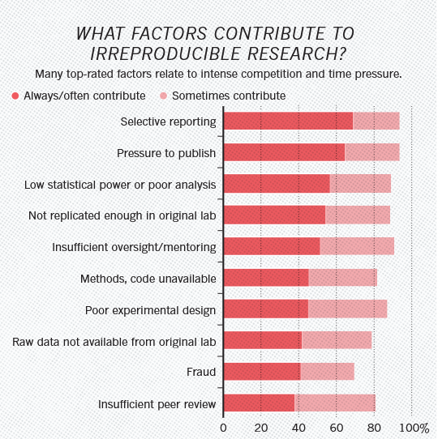
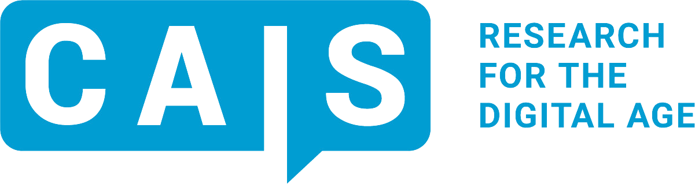

## AGENDA {.agenda-slide}
<!-- Klasse: .agenda-slide -->

1. Krisis Replikasi: Pengenalan Istilah, Bukti, dan Cakupannya
2. Apa Penyebabnya?
3. Seperti Apa Klaim Ilmiah yang *Epistemically Valuable*?
4. Kesimpulan

## {.section-slide}
<!-- Zwischentitelfolie 01 -->

::: {.section-number}
01
:::

::: {.section-bubble}
Krisis Replikasi: Pengenalan Istilah, Bukti, dan Cakupannya
:::

## Mari Kita Mulai dengan Sebuah *Thought Experiment*

::: {.lead}
Anda membaca sebuah temuan menarik di suatu jurnal top dan membayangkan *paper* ini akan menjadi landasan fundamental dari riset Anda.
:::

::: {.incremental}

- **Pertanyaan 1:** Jika tim peneliti lain mencoba ulang *studi yang sama dengan mengambil data baru*, apakah mereka akan menemukan hasil yang sama?
- **Pertanyaan 2:** Jika tim peneliti lain menganalisis ulang *data asli dengan material asli* dari penelitian tersebut, apakah mereka akan mendapatkan hasil yang sama persis seperti yang dilaporkan dalam artikel ilmiah tersebut?
- Secara intuitif, banyak yang berasumsi jawaban untuk keduanya adalah "*ya, tentu saja! Paper ini, kan, sudah dipublikasikan di jurnal top Q1!*".
- Selama 15 tahun terakhir, para peneliti benar-benar mengeceknya dan jawabannya... **membuat banyak orang kecewa**.

:::

## Agar lebih jelas, mari kita bedakan tiga hal ini {.columns-slide}

::: {.lead}
Berdasarkan [Barba (2018)](https://arxiv.org/abs/1802.03311) dan [The Turing Way](https://book.the-turing-way.org/), kebanyakan orang sering mencampuradukkan istilah-istilah ini:
:::

::: {.columns-area}
::: {.col-item}
[<i class="fa-solid fa-rotate-right"></i>]{.col-icon}

### *Reproducibility* (🇮🇩 "reka ulang")

**Data sama + analisis sama → hasil sama.** Peneliti lain (atau tim peneliti yang sama) menjalankan ulang analisis yang sama, pada data yang sama, dan mendapatkan hasil yang sama persis seperti dilaporkan di artikel ilmiah. ***Resep dan bahan yang sama, dimasak ulang.***
:::
::: {.col-item}
[<i class="fa-solid fa-people-group"></i>]{.col-icon}

### *Replicability* (🇮🇩 "coba ulang")

**Data baru + metode sama → hasil serupa.** Tim peneliti independen mengulang studi tersebut dengan partisipan baru dan menemukan kesimpulan yang sebanding dengan penelitian aslinya. ***Resep yang sama, dimasak menggunakan bahan yang baru.***
:::
::: {.col-item}
[<i class="fa-solid fa-lightbulb"></i>]{.col-icon}

### *Robustness* (🇮🇩 "keandalan")

**Data sama + analisis baru → hasil sama, atau setidaknya kesimpulan yang serupa.** Temuan penelitian tetap stabil meskipun menggunakan strategi analitis yang berbeda. ***Resep dieksekusi dengan bahan yang sama, tetapi dengan teknik memasak yang berbeda.***
:::
:::

## Hasil Coba Ulang

::: {.lead}
Berapa banyak klaim ilmiah yang terkonfirmasi saat studinya dicoba ulang dengan data baru?
:::

::: {.infographic}
::: {.infographic-cols}
::: {.infographic-item}
[36%]{.stat}

dari 100 studi **psikologi** ([Open Science Collaboration, 2015](https://www.science.org/doi/10.1126/science.aac4716))
:::
::: {.infographic-item}
[46%]{.stat}

dari 112 klaim ilmiah (dari 50 eksperimen yang diterbitkan di 23 artikel) di **biologi kanker praklinis** ([Errington dkk., 2021](https://elifesciences.org/articles/71601)). Awalnya, tim peneliti merencanakan untuk mencoba ulang 193 eksperimen dari 53 artikel dengan *impact factor* yang tinggi (2010–2012), tetapi hanya 50 eksperimen dari 23 artikel yang bisa dikerjakan.
:::
::: {.infographic-item}
[61%]{.stat}

dari 18 eksperimen laboratorium **ekonomi** ([Camerer dkk., 2016](https://www.science.org/doi/10.1126/science.aaf0918))
:::
::: {.infographic-item}
[49%]{.stat}

dari 164 artikel yang dipilih acak (berisi 274 klaim) yang dicoba ulang dengan data *baru* di **6 disiplin** di ilmu sosial dan perilaku, melalui [*project* SCORE](https://www.cos.io/score). Median *effect size* di studi coba ulang ini turun dari *r* = 0,25 menjadi 0,10 ([Tyner dkk., 2026](https://www.nature.com/articles/s41586-025-10078-y))
:::
:::
:::

::: {.incremental}

- Bahkan ketika temuannya berhasil dicoba ulang, rata-rata *effect size*-nya **hanya sekitar setengah** dari yang dilaporkan pada awalnya (dikenal sebagai "[The Decline Effect](https://www.frontiersin.org/journals/psychology/articles/10.3389/fpsyg.2019.02874/full)")—[*project* SCORE](https://www.forbes.com/sites/michaeltnietzel/2026/04/04/only-about-half-of-social-science-results-can-be-replicated-finds-new-study/) menemukan pola yang sama lagi pada 2026.
- Karena pola masalah ini terlihat dalam riset dalam skala besar, apa yang disebut media sebagai **"[krisis replikasi](https://www.nature.com/articles/d41586-026-00955-5)"** sepertinya memang benar-benar terjadi.

:::

## Apa Kata Para Peneliti?

::: {.lead}
*Nature* menyurvei 1.576 peneliti dari berbagai disiplin ilmu ([Baker, 2016](https://www.nature.com/articles/533452a.pdf)).
:::

::: {.infographic}
::: {.infographic-cols}
::: {.infographic-item}
[>70%]{.stat}

peneliti bidang kimia dan biologi pernah gagal mencoba ulang eksperimen peneliti lain
:::
::: {.infographic-item}
[>50%]{.stat}

peneliti bidang kimia, biologi, fisika, teknik, dan medis pernah gagal mencoba ulang eksperimen **mereka sendiri**
:::
::: {.infographic-item}
[~90%]{.stat}

menganggap ada krisis replikasi; dengan rincian 52% menyatakan krisisnya signifikan, dan 38% menyatakan ada *slight crisis*
:::
:::
:::

::: {.callout-note appearance="simple" .fragment}
Mayoritas ilmuwan yang berpartisipasi dalam survei ini mengakui bahwa krisis replikasi memang benar-benar terjadi.
:::

## Bahkan Direka Ulang pun Sulit

::: {.lead}
Mari lupakan proses coba ulang yang membutuhkan data baru. Bisakah klaim ilmiah direka ulang dari data dan material aslinya?
:::

::: {.infographic}
::: {.infographic-cols}
::: {.infographic-item}
[22/67]{.stat}

artikel di bidang **ekonomi** yang diterbitkan di 13 jurnal terkemuka bisa direka ulang tanpa menghubungi penulis ([Chang & Li, 2015](https://www.federalreserve.gov/econresdata/feds/2015/files/2015083pap.pdf))
:::
::: {.infographic-item}
[11/35]{.stat}

artikel yang diterbitkan di jurnal *Cognition*, yang mewajibkan data terbuka, bisa direka ulang tanpa bantuan penulis aslinya ([Hardwicke dkk., 2018](https://royalsocietypublishing.org/doi/10.1098/rsos.180448))
:::
::: {.infographic-item}
[1/14]{.stat}

artikel yang memiliki [*badge open data*](https://www.cos.io/initiatives/badges) di *Psychological Science* bisa direka ulang persis sama ([Crüwell dkk., 2023](https://journals.sagepub.com/doi/10.1177/09567976221140828))
:::
::: {.infographic-item}
[54%]{.stat}

dari 143 klaim ilmiah di ilmu sosial dan perilaku bisa direka ulang persis sama dari data dan material riset aslinya ([Miske dkk., 2026](https://www.nature.com/articles/s41586-026-10203-5))
:::
:::
:::

## {.section-slide}
<!-- Zwischentitelfolie 02 -->

::: {.section-number}
02
:::

::: {.section-bubble}
Apa Penyebabnya?
:::

## Mengapa Krisis Ini Bisa Terjadi?

::: {.lead}
Umumnya, bukan semata-mata karena niat jahat/kecurangan, tetapi karena respons naluriah manusia yang mengikuti bagaimana sistem insentif bekerja.
:::

::: {.incremental}

- ***Publication selection bias***: peneliti melaporkan hasil penelitiannya secara selektif, menyimpang dari prinsip bahwa temuan penelitian perlu dilaporkan secara lengkap, menyeluruh dan apa adanya ([Bartoš, dkk., 2024](https://researchonline.lse.ac.uk/id/eprint/122107/)). 
  * Sebabnya, artikel ilmiah yang menyajikan temuan yang baru yang "positif" punya peluang lebih besar diterbitkan jurnal ilmiah. Akhirnya, hasil negatif/*null* umumnya tersembunyi ([*file drawer*](https://web.ma.utexas.edu/users/mks/statmistakes/filedrawer.html), atau [*suppresion of negative findings*](https://researchonline.lse.ac.uk/id/eprint/122107/)).
  * Agar hasil penelitian yang negatif tadi *publishable*, maka perlu "dimodifikasi" agar hasilnya positif ([*conversion of negative results*](https://researchonline.lse.ac.uk/id/eprint/122107/)).
  * Ini menunjukkan bahwa literatur ilmiah terkontaminasi bias yang serius, sehingga tidak mencerminkan realitas yang sebenarrnya ingin dijelaskan.
  * Ketika *publication selection bias* ini dikendalikan secara statistik, maka klaim ilmiah di bidang kedokteran, *environmental science*, psikologi, dan ekonomi *substantially* makin sulit ditemukan kembali ([Bartoš, dkk., 2024](https://researchonline.lse.ac.uk/id/eprint/122107/))
  * *Publication selection bias* adalah penyebab utama krisis replikasi dan merupakan *downstream consequences* atas penyebab lainnya yang akan diuraikan di bagian setelah ini.

:::

## Mengapa Krisis Ini Bisa Terjadi?

::: {.lead}
Umumnya, bukan semata-mata karena niat jahat/kecurangan, tetapi karena respons naluriah manusia yang mengikuti bagaimana sistem insentif bekerja.
:::

::: {.incremental}

- ***Publish or perish***: karier akademik dibangun berdasarkan *jumlah* publikasi, bukan kualitas substantifnya.
- ***Questionable research practices* (QRPs)**: area abu-abu antara praktik baik dan kecurangan akademik ([John et al., 2012](https://journals.sagepub.com/doi/10.1177/0956797611430953)):
  - ***p*-*hacking***: mencoba banyak analisis dan hanya melaporkan yang "berhasil"
  - **HARKing**: *Hypothesizing After the Results are Known* — menyajikan temuan eksploratif seolah-olah memang sudah diprediksi sebelumnya ([Kerr, 1998](https://journals.sagepub.com/doi/10.1207/s15327957pspr0203_4)).
  - **Pelaporan selektif** (*selective reporting*) terhadap pengukuran, kondisi (eksperimen), atau temuan penelitian.
- ***The garden of forking paths***: bahkan tanpa niat buruk sekalipun, setiap dataset memungkinkan pilihan analisis yang sangat banyak dan sama-sama bisa dipertahankan secara metodologis, sehingga fleksibilitas dalam pilihan cara menganalisis data bisa meningkatkan *false positive rate* ([Gelman & Loken, 2014](http://www.stat.columbia.edu/~gelman/research/unpublished/p_hacking.pdf)).

:::

## Mengapa Krisis Ini Bisa Terjadi?

::: {.lead}
Apa kata 1.576 peneliti yang disurvei *Nature* ([Baker, 2016](https://www.nature.com/articles/533452a.pdf))?
:::

{fig-align="center"}

## {.section-slide}
<!-- Zwischentitelfolie 03 -->

::: {.section-number}
03
:::

::: {.section-bubble}
Seperti Apa Klaim Ilmiah yang *Epistemically Valuable*?
:::

## Klaim Ilmiah dan Coba Ulang

::: {.lead}
Apakah semua klaim ilmiah yang punya nilai epistemik harus dapat dicoba ulang, direka ulang, dan selalu bertahan ketika diuji dengan cara yang berbeda?
:::

::: {.incremental}

- Barangkali, tidak semua klaim ilmiah perlu dicoba ulang, direka ulang atau dicek keandalan analisisnya? 
  * Selama klaim ilmiah mengandung tafsiran inferensi (e.g., asosiasi, kausalitas) dan dibatasi oleh data empirik, maka kegagalan dalam mencapai tiga aspek ini menunjukkan persoalan validitas atas klaim tersebut.
- Barangkali, ada fenomena-fenomena yang dipelajari di bidang ilmu tertentu akan selalu *bounded* dengan konteks (sosial) yang menyertainya?
  * Selama fenomena/klaim ilmiah ini ditafsirkan sebagai inferensi dan dibatasi oleh data, maka konteks sosial ini harus dispesifikasi di dalam teori/hipotesis yang akan diuji sebagai *boundary condition* (lihat [argumen saya di sini](https://sciencewatchdog.id/2026/06/18/kuanti-vs-kuali-mana-yang-sahih-menentukan-kebenaran/)). 
:::

## Klaim Ilmiah dan Coba Ulang

::: {.lead}
Apakah semua klaim ilmiah yang punya nilai epistemik harus dapat dicoba ulang, direka ulang, dan selalu bertahan ketika diuji dengan cara yang berbeda?
:::

::: {.incremental}

- Barangkali, cara terbaik untuk mempelajari suatu fenomena adalah justru dengan membiarkannya gagal dicoba ulang dan melihat faktor apa yang membuatnya gagal dicoba ulang?
  * Ketika tujuannya adalah *theory/hypothesis generation*, maka tujuan ini perlu dibuat eksplisit dan dipisahkan dengan riset yang tujuannya *theory/hypothesis testing*.
- Barangkali, krisis replikasi adalah sesuatu yang cenderung dilebih-lebihkan karena proses ini sangat normal dalam sains? (ingat *paradigm shift* yang diajukan Thomas Kuhn).
  * Kombinasi antara *publication selection bias* dan krisis replikasi menunjukkan ini bukan "krisis biasa" seperti yang digambarkan Kuhn.
- Barangkali, gagalnya coba ulang hanya menunjukkan *tiadanya bukti* atas suatu argumen/klaim, bukan berarti argumen/klaim tersebut *tidak ada*?
  * Kalau begitu, argumen teoretis yang melandasi hipotesis perlu dispesifikasikan dengan lebih baik agar ia bertahan di pengujian selanjutnya.
:::

## Apa yang Perlu Dilakukan Agar Klaim Ilmiah *Epistemically Valuable*?

::: {.lead}
Krisis replikasi benar-benar terjadi dan merupakan masalah serius. Lalu, apa yang dapat dilakukan untuk mengatasi masalah ini?
:::

::: {.incremental}
* Memperkuat sistem tinjauan sejawat dan verifikasi 
  + ...karena sistem tinjauan sejawat yang kita kenal selama ini terbukti tidak bekerja sebagaimana mestinya.
  + *Reviewer* membaca naskah dan jarang mengulang proses analisisnya.
  + Tidak dibayar, dikerjakan di sela pekerjaan lain, biasanya oleh dua atau tiga orang.
  + Bisa mendeteksi kesalahan yang tampak jelas di naskah, tetapi tidak dirancang untuk mendeteksi kesalahan yang mengendap dalam siklus penelitian.
  + Seandainya ilmuwan adalah *food influencer*, apa yang harus dilakukan agar klaim ilmiahnya dapat "di-*recook*" ilmuwan lainnya? 
* [*Registered Report*](https://onlinelibrary.wiley.com/doi/abs/10.1111/add.12728)
  + Kalau *publication selection bias* adalah akarnya, bagaimana kalau proses tinjauan sejawat dimulai sebelum data dikumpulkan?
  + ...lalu jurnal akan tetap menerbitkan artikel tsb. terlepas seperti apapun hasilnya.
:::

## {.section-slide}
<!-- Zwischentitelfolie 04 -->

::: {.section-number}
04
:::

::: {.section-bubble}
Kesimpulan
:::

## Kredibilitas Lahir dari Verifikasi, Bukan dari Reputasi Jurnal

::: {.lead}
Terbit di jurnal top Q1 bukan jaminan bahwa sebuah klaim ilmiah benar. Klaim ilmiah baru layak dipercaya jika ia dapat diverifikasi: direka ulang, dicoba ulang, dan tetap bertahan ketika dianalisis dengan cara yang berbeda.
:::

::: {.incremental}

- **Krisis replikasi memang terjadi dan cakupannya lintas disiplin.** Hanya sekitar separuh klaim ilmiah di ilmu sosial dan perilaku yang berhasil dicoba ulang, *effect size*-nya menyusut hingga setengahnya, dan bahkan dengan data serta material asli pun hanya 54% klaim yang bisa direka ulang persis sama.
- **Akarnya sistemik, bukan semata-mata individual.** *Publication selection bias*, yang dipupuk oleh budaya *publish or perish* dan QRPs, membuat literatur ilmiah tidak lagi mencerminkan realitas yang ingin dijelaskannya.
- **Tidak semua kegagalan berarti klaimnya keliru**, tetapi klaim yang bersifat inferensial dan dibatasi data harus bisa diverifikasi. Konteks perlu dispesifikasi sebagai *boundary condition*, dan riset yang sifatnya eksploratif perlu dipisahkan secara eksplisit dari riset yang menguji teori secara *confirmatory*.
- **Solusinya juga harus struktural**: verifikasi (reka ulang) menjadi bagian dari tinjauan sejawat, dan *Registered Report* memutus ketergantungan publikasi pada hasil penelitian.
- Jadi, ketika Anda membaca temuan menarik di jurnal top lagi, pertanyaannya bukan lagi "*di jurnal apa paper ini terbit?*", melainkan "**bisakah klaim ini diverifikasi?**"

:::

## {.closing-slide .no-footer}

::: {.closing-left}
::: {.closing-contact-box}
**Dr. Rizqy Amelia Zein**\
Center for Advanced Internet Studies (CAIS) & Universitas Airlangga\
E-mail: [amelia.zein@cais-research.de](mailto:amelia.zein@cais-research.de) · Homepage: [rameliaz.github.io](https://rameliaz.github.io/)
:::

::: {.closing-cais-logo}

:::
:::

::: {.closing-right}
::: {.closing-text}
Terima kasih!

:::

::: {.closing-bottom}
::: {.closing-org}
Center for Advanced Internet Studies (CAIS) gGmbH

Konrad-Zuse-Str. 2a, 44801 Bochum
:::

::: {.closing-contact-info}
[info@cais-research.de](mailto:info@cais-research.de)\
+49 234 9531 5000\
[www.cais-research.de](https://www.cais-research.de)
:::

::: {.closing-social}
<a href="https://www.linkedin.com/company/center-for-advanced-internet-studies" title="LinkedIn"><i class="fa-brands fa-linkedin-in"></i></a>
<a href="https://bsky.app/profile/cais-research.bsky.social" title="Bluesky"><i class="fa-brands fa-bluesky"></i></a>
<a href="https://www.instagram.com/caisnrw/" title="Instagram"><i class="fa-brands fa-instagram"></i></a>
<a href="https://mastodon.social/@CAISnrw" title="Mastodon"><i class="fa-brands fa-mastodon"></i></a>
<a href="https://www.facebook.com/CenterforAdvancedInternetStudies" title="Facebook"><i class="fa-brands fa-facebook-f"></i></a>
<a href="https://www.youtube.com/channel/UClCqAar9lGav5spwJOJgrUw" title="YouTube"><i class="fa-brands fa-youtube"></i></a>
:::
:::
:::
