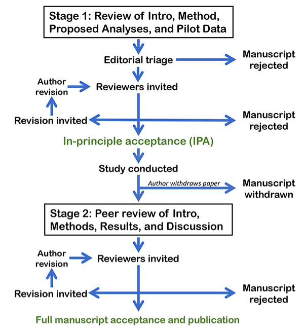

## AGENDA {.agenda-slide}
<!-- Klasse: .agenda-slide -->

1. Replication Crisis and Why Does Reproducibility Matters
2. Data Management Plan
3. Pre-Registration
4. Literate Programming
5. Registered Reports
6. Conclusions

## {.section-slide}
<!-- Zwischentitelfolie 01 -->

::: {.section-number}
01
:::

::: {.section-bubble}
Replication Crisis — and Why Reproducibility Matters
:::

## Let's Start With a Thought Experiment

::: {.lead}
You read a fascinating finding in a top journal and want to build your dissertation on it.
:::

::: {.incremental}

- **Question 1:** If another team ran the *same study again with new participants*, would they find the same result?
- **Question 2:** If you took the *original data and the original analysis code*, would you get the same numbers reported in the paper?
- Intuitively, we assume the answer to both is "*yes, of course it should be! It's published science in a top Q1 journal!*"
- Over the last 15 years, researchers actually checked. The answers were... **rather uncomfortable**.

:::

## How It Started (early 2010s)

::: {.incremental}

- **2011 — Bem's "precognition" paper**: a top journal (Journal of Personality and Social Psychology - JPSP) published evidence that people can *feel the future* ([Bem, 2011](https://psycnet.apa.org/record/2011-01894-001)) by using standard methods and standard statistics. If the method can "prove" the impossible, what does that say about the method?
- [**2011 — The Stapel fraud case**](https://www.nytimes.com/2013/04/28/magazine/diederik-stapels-audacious-academic-fraud.html): a prominent social psychologist was found to have fabricated data in dozens of published papers.
- **2011 — "False-Positive Psychology"** ([Simmons, Nelson, & Simonsohn](https://journals.sagepub.com/doi/10.1177/0956797611417632)): showed that ordinary, small, undisclosed analytic choices can make *anything* statistically significant — they "demonstrated" that listening to a song makes people younger.
- These events triggered a field-wide question: **how much of our literature can we actually trust?**

:::

## But the problem started much earlier than that

{fig-align="center" width="60%"}

## The Multi-Site Replication Projects

::: {.lead}
Large teams systematically re-ran published studies with new data, and here is what came back:
:::

::: {.infographic}
::: {.infographic-cols}
::: {.infographic-item}
[36%]{.stat}

of 100 psychology studies replicated — [Open Science Collaboration (2015)](https://www.science.org/doi/10.1126/science.aac4716)
:::
::: {.infographic-item}
[61%]{.stat}

of 18 economics lab experiments replicated — [Camerer et al. (2016)](https://www.science.org/doi/10.1126/science.aaf0918)
:::
::: {.infographic-item}
[62%]{.stat}

of 21 social-science studies from *Nature* & *Science* replicated — [Camerer et al. (2018)](https://www.nature.com/articles/s41562-018-0399-z)
:::
::: {.infographic-item}
[49%]{.stat}

of 164 papers across 12 disciplines replicated — COS **SCORE project** ([Nature, April 2026](https://www.cos.io/about/news/large-scale-collaboration-releases-new-findings-on-research-credibility))
:::
:::
:::

::: {.incremental}

- Even when effects did replicate, they were on average **only about half as large** as originally reported (i.e., "[The Decline Effect](https://www.frontiersin.org/journals/psychology/articles/10.3389/fpsyg.2019.02874/full)") — SCORE found the same pattern again in 2026.
- **SCORE is the largest check yet**: 865 researchers assessed 3,900 papers (2009–2018, 62 journals, spanning economics, psychology, political science, sociology, and more). Reproducing published analyses on the *original* data succeeded [only 54% of the time](https://www.nature.com/articles/s41586-026-10203-5).
- This pattern, across psychology, economics, and beyond, now confirmed at scale, is what the media dubbed the **"[replication crisis](https://www.nature.com/articles/d41586-026-00955-5)."**

:::

## Three Words You Must Not Confuse {.columns-slide}

::: {.lead}
Following [Barba (2018)](https://arxiv.org/abs/1802.03311) and [The Turing Way](https://book.the-turing-way.org/), people mix these up all the time:
:::

::: {.columns-area}
::: {.col-item}
[<i class="fa-solid fa-rotate-right"></i>]{.col-icon}

### Reproducibility (🇮🇩 "*reka ulang*")

**Same data + same analysis → same result.** Someone else (or future you) re-runs *your* analysis on *your* data and gets the numbers in your paper. 
:::
::: {.col-item}
[<i class="fa-solid fa-people-group"></i>]{.col-icon}

### Replicability (🇮🇩 "*coba ulang*")

**New data + same method → similar result.** An independent team repeats the study with new participants and finds a comparable effect.
:::
::: {.col-item}
[<i class="fa-solid fa-lightbulb"></i>]{.col-icon}

### Robustness (🇮🇩 "*keandalan*")

**Same data + new analysis → same result or at least, similar conclusion.** The finding remains stable when different analytical strategies are used.
:::
:::

## Notice the Differences

{fig-align="center"}

## The Really Uncomfortable Part

::: {.lead}
Let's forget collecting new data (i.e., replication) for a moment. Can we even reproduce the *original numbers* from the *original data*? (i.e., "reproducibility")
:::

::: {.incremental}

- [Hardwicke et al. (2018)](https://royalsocietypublishing.org/doi/10.1098/rsos.180448) tried to reproduce results from papers with *mandatory open data* in the journal *Cognition*: only 11 of 35 papers were reproducible without help from the original authors.
- [Artner et al. (2021)](https://psycnet.apa.org/record/2020-81352-001) could reproduce only ~70% of major statistical claims from published psychology articles and some only after considerable detective work.
- [Crüwell et al. (2023)](https://journals.sagepub.com/doi/10.1177/09567976221140828) checked "open data" badges in *Psychological Science*: only 1 out of 14 articles was rated fully computationally reproducible.
- And this directly affects people's lives: the famous **Reinhart & Rogoff** austerity paper, which is widely used to justify real economic policies, contained a simple **Excel error** discovered only when a graduate student got the spreadsheet ([Herndon et al., 2014](https://academic.oup.com/cje/article/38/2/257/1714018)).

:::

## Why Does This Happen?

::: {.lead}
It's mostly not fraud, but rather ordinary incentives acting on ordinary humans.
:::

::: {.incremental}

- **Publication bias**: journals prefer novel, positive, "clean" results. Therefore, null results are often being kept into the file drawer.
- **Publish or perish**: careers are built on the *number* of publications, not on their substantive quality.
- **Questionable research practices (QRPs)**: a grey zone between good practice and misconduct ([John et al., 2012](https://journals.sagepub.com/doi/10.1177/0956797611430953)):
  - ***p*-hacking**: trying many analyses and reporting the one that "works"
  - **HARKing**: *Hypothesizing After the Results are Known* — presenting an exploratory finding as if predicted ([Kerr, 1998](https://journals.sagepub.com/doi/10.1207/s15327957pspr0203_4))
  - **Selective reporting** of measures, conditions, or outcomes
- **The garden of forking paths**: even without bad intent, every dataset offers countless defensible analysis choices, thus flexibility in analytical choices can inflate false positives ([Gelman & Loken, 2014](http://www.stat.columbia.edu/~gelman/research/unpublished/p_hacking.pdf)).

:::

## {.quote-slide}

::: {.quote-bubble}
> An article about computational science in a scientific publication is not the scholarship itself, it is merely advertising of the scholarship. The actual scholarship is the complete software development environment and the complete set of instructions which generated the figures.

::: {.quote-author}
[Buckheit & Donoho (1995)](https://link.springer.com/chapter/10.1007/978-1-4612-2544-7_5), paraphrasing Jon Claerbout
:::
:::

## Why Should *You* Care? {.text-slide-bg}

::: {.lead}
Ensuring that our results are reproducible gives us more confidence in our work.
:::

::: {.content-box}
- **Your closest collaborator is you, six months ago** and past-you does not answer Whatsapp chats. A reproducible workflow means you can always retrace your own steps.
- **Errors get caught early**, before they end up in your dissertation, your defense, or a retraction.
- **International reviewers, supervisors, and committees increasingly expect it**. Funders and journals now routinely require data, code, and analysis plans.
- **It makes you more efficient**. Re-running an analysis after your supervisor/reviewers ask "*please just add this one covariate*" takes one click instead of one week.
- **It builds trust in your work**. Reproducible research gets reused, cited, and extended.
:::

## A "Reproducibility Ladder"🪜

::: {.lead}
Start with the practice **you really need**, not the one **you want**. The four practices in this talk are *not supposed to be* a to-do list to finish this semester, or even the whole PhD program. They are a ladder you climb over years of your future professional career.
:::

::: {.incremental}
- **Rung 1 — Data Management Plan**: lowest barrier, most direct benefit. A folder that anyone, including future you, can navigate.
- **Rung 2 — Pre-Registration**: a planning discipline — write the hypothesis down before you know the answer.
- **Rung 3 — Literate Programming**: a technical habit — let the document compute itself instead of copying numbers by hand.
- **Rung 4 — Registered Reports**: the biggest commitment — review before results exist, over years.
- This is the order **I personally** climbed it, over about 15 years of my scientific career. I'll show you what each rung actually looked like from where I stood.
:::

## {.section-slide}
<!-- Zwischentitelfolie 02 -->

::: {.section-number}
02
:::

::: {.section-bubble}
Data Management Plan
:::

## What Is a Data Management Plan (DMP)?

::: {.lead}
A short, living document, written **before** you collect data, describing how data will be collected, documented, stored, protected, and shared.
:::

::: {.incremental}

- Think of it as answering, in advance: *"If I disappeared tomorrow, could someone else find, understand, and use my data?"*
- Increasingly **required by funders** (DFG, ERC, NIH, and many national funders) and by ethics committees.
- It forces the right questions at the right time, *before* problems become unfixable (e.g., a consent form that forbids data sharing).
- Free tools with templates and guidance: [DMPTool](https://dmptool.org) and [DMPonline](https://dmponline.dcc.ac.uk).
- These are some good examples: [Example 1](https://www.fu-berlin.de/en/sites/forschungsdatenmanagement/_dokumente/dmp-sample_v01.pdf), [Example 2](https://data.ncl.ac.uk/articles/data_management_plan/Data_management_plan/23541882/1?file=41295288), [Example 3](https://zenodo.org/records/8411137), [DCC UK DMP Database](https://dmponline.dcc.ac.uk/public_plans).

:::

## From My Own Work: Writing the DMP Habit Into a Live Project

::: {.lead}
I'm working on a scoping review of reproducibility practices in economics and social science, which is a part of a larger project I'm participated in. The structure of the working folder looks like this:
:::

::: {.content-box}
```text
litsearch/
├── codes/                        R scripts
├── coding/                       Codebooks, coding sheets, and Google Form/Sheet
├── dataset/                      Analysis-ready datasets exported from coding
├── output/
│   ├── search_output/            Literature search pipeline outputs (01–11)
│   ├── analysis_output/          Tables and figures from the analysis
│   └── cleaning_log/             Data-quality flags from response cleaning
└── protocol_logbook.docx         Protocol and decisions logbook
```

- Every file also gets one sentence of description — e.g. `10_final_set.xlsx`: *"The 145-paper final corpus... verified against Zotero subcollection RIS exports."* [See the README here](libs/README.md).
- **Benefit #1 — future me**: I come back to this folder after months on other tasks and know exactly where to look.
- **Benefit #2 — future readers**: when this becomes a published paper (hopefully!), reviewers and readers can verify anything I did.
:::

## What Goes Into a DMP? {.columns-slide}

::: {.columns-area}
::: {.col-item}
[<i class="fa-solid fa-file-lines"></i>]{.col-icon}

### Documentation

What data will you collect and how? Which formats? A **codebook** describing every variable (name, question wording, coding, missing values) so the data are interpretable without you.
:::
::: {.col-item}
[<i class="fa-solid fa-shield-halved"></i>]{.col-icon}

### Storage & Ethics

Where do the data live, how are they backed up ([3-2-1 rule](https://en.wikipedia.org/wiki/Backup)), who has access? How are participants protected, including informed consent, anonymization or pseudonymization, legal requirements?
:::
::: {.col-item}
[<i class="fa-solid fa-share-nodes"></i>]{.col-icon}

### Sharing & Preservation

Which data can be shared, where, [under what license](https://id.creativecommons.net/pilihan-lisensi-cc/), and when? What is archived long-term (typically 10 years) and in which trusted repository?
:::
:::

## FAIR Data

::: {.lead}
The guiding standard for shared research data ([Wilkinson et al., 2016](https://www.nature.com/articles/sdata201618)), data should be **FAIR**:
:::

::: {.infographic}
::: {.infographic-cols}
::: {.infographic-item}
[F]{.stat}

**Findable** — deposited with a persistent identifier (DOI) and rich metadata
:::
::: {.infographic-item}
[A]{.stat}

**Accessible** — retrievable via standard protocols; access conditions are clear
:::
::: {.infographic-item}
[I]{.stat}

**Interoperable** — open formats (CSV, not only SPSS), standard vocabularies
:::
::: {.infographic-item}
[R]{.stat}

**Reusable** — clear license, provenance, and enough documentation to reuse
:::
:::
:::

- Important: **FAIR ≠ open**. The principle is *"as open as possible, as closed as necessary."* Sensitive data can be FAIR while under restricted access.

## Practical Habits That Cost Practically Nothing {.text-slide-bg}

::: {.content-box}
- **File naming**: machine-readable, human-readable, sortable — `2026-07-08_study1_raw.csv`, not `data baru FINAL (2).sav`. No spaces, no special characters, dates as YYYY-MM-DD.
- **Raw data are sacred**: store them read-only, in one place; all changes happen via scripts into `data/processed/`.
- **Write the codebook while you build the survey**.
- **Choose a repository, not a personal website**: [OSF](https://osf.io), [Zenodo](https://zenodo.org), [PsychData](https://www.psychdata.de), [RIN Dataverse (BRIN)](https://data.brin.go.id/) — they provide DOIs and long-term preservation. 
- [**Pick a license**](https://www.imperial.ac.uk/research-and-innovation/support-for-staff/scholarly-communication/research-data-management/sharing-data/licensing-your-data/) so others know what they may do: e.g., [CC0/CC-BY](https://id.creativecommons.net/pilihan-lisensi-cc/) for data and materials, [MIT/GPL](https://www.credativ.de/en/blog/credativ-inside/understanding-open-source-licenses-gpl-mit-apache-compared/) for code.
- **Plan consent for sharing**: add data-sharing language to your informed consent *now*, as you cannot retroactively ask 800 anonymous participants.
:::

## {.section-slide}
<!-- Zwischentitelfolie 03 -->

::: {.section-number}
03
:::

::: {.section-bubble}
Pre-Registration
:::

## The Problem Pre-Registration Solves

::: {.incremental}

- Remember the **garden of forking paths**: with enough flexibility, *some* significant result can almost always be found.
- Statistics can only do its job if the distinction between two modes of research is honest:
  - **Confirmatory** research: hypotheses specified *before* seeing the data → *p*-values are meaningful tests.
  - **Exploratory** research: patterns discovered *in* the data → valuable for generating hypotheses, but *p*-values no longer mean what they claim.
- Both are legitimate! The problem is **presenting exploration as confirmation** (HARKing).
- **Pre-registration** restores the distinction: you write down your hypotheses, design, and analysis plan **before** data collection, in a **time-stamped, read-only** registry ([Nosek et al., 2018](https://www.pnas.org/doi/10.1073/pnas.1708274114)).

:::

## From My Own Work: Locking In the Hypothesis Before the Data

::: {.lead}
One of my clearer examples: [*"Science and Religion in the Times of Crisis"*](https://osf.io/ctru2/overview), pre-registered on OSF.
:::

::: {.content-box}
- The study tests the **"dilution effect"**: whether offering *more* explanations for a crisis reduces how useful people find *each* explanation ([Jackson et al., 2024](https://osf.io/ctru2/overview)).
- I wrote the hypothesis down, in a time-stamped, public record, **before** I knew whether the data would support it.
- It greatly helped me to **plan my study better** and defend my design choice when discussing it with my supervisor.
- Whatever came back, I could not simply reframe the study afterward as "this is what I predicted all along." The time-stamp made that impossible and that **helps keeping me honest with myself**.
- I have pre-registered every study I have run since 2021.
  + It is now simply normal part of designing a study.
:::

## What Goes Into a Pre-Registration? {.columns-slide}

::: {.lead}
Free registries with templates: [OSF Registries](https://osf.io/registries) and [AsPredicted](https://aspredicted.org). Typical contents:
:::

::: {.columns-area}
::: {.col-item}
[<i class="fa-solid fa-clipboard-question"></i>]{.col-icon}

### Hypotheses & Design

Directional hypotheses, IVs and DVs with exact operationalizations, study design, conditions, and procedure.
:::
::: {.col-item}
[<i class="fa-solid fa-users"></i>]{.col-icon}

### Sample & Exclusions

Target sample size **with justification** (e.g., power analysis), stopping rule, and exclusion criteria.
:::
::: {.col-item}
[<i class="fa-solid fa-chart-line"></i>]{.col-icon}

### Analysis Plan

The exact statistical model for each hypothesis, handling of missing data and outliers, inference criteria plus what you will do if assumptions fail.
:::
:::

## Common Worries (and Why They're Mostly Unfounded)

::: {.incremental}

- **"It's a prison — I can't deviate."** You can! Deviations are fine; you just report them transparently ("we deviated from the plan because..."). The registry only makes deviations *visible*.
- **"It kills exploration."** No. You can explore freely; results are simply labelled as exploratory. Many templates even have a section for planned exploratory analyses.
- **"Someone will scoop my idea."** Registrations can be **embargoed** (kept private) until you publish.
- **"It's too much work."** An [AsPredicted](https://aspredicted.org/) registration is 9 questions. And most of it is text you need for your ethics application and methods section anyway. You are basically writing it *earlier*.
- **Caveat**: pre-registration is not magic. Many pre-registrations are vague, and deviations are common and often unreported ([van den Akker et al., 2024](https://psycnet.apa.org/fulltext/2025-33919-001.html)). The value comes from *specific* plans and *transparent* reporting, which is a skill you can practice from your very first study.

:::

## {.section-slide}
<!-- Zwischentitelfolie 04 -->

::: {.section-number}
04
:::

::: {.section-bubble}
Literate Programming
:::

## The Copy-Paste Workflow (a.k.a. How Errors Are Born)

::: {.lead}
The traditional workflow in psychology looks like this:
:::

::: {.incremental}

- Run the analysis in SPSS by clicking through menus...
- ...copy the numbers into a Word document by hand...
- ...format the table manually...
- ...then a reviewer asks you to exclude three participants and you do **all of it again**, hoping you click the same buttons.
- Every manual step is a place where errors sneak in and nobody (including you) can later verify what exactly was done.
  + Even if someone were to check, it would take a tremendous amount of effort, time, and energy to do so.
- Roughly **half of published psychology papers contain at least one inconsistent statistic** — e.g., a *p*-value that does not match its own test statistic ([Nuijten et al., 2016](https://link.springer.com/article/10.3758/s13428-015-0664-2)).

:::

## {.quote-slide}

::: {.quote-bubble}
> Let us change our traditional attitude to the construction of programs: Instead of imagining that our main task is to instruct a computer what to do, let us concentrate rather on explaining to human beings what we want a computer to do.

::: {.quote-author}
[Donald Knuth (1984), *Literate Programming*](https://academic.oup.com/comjnl/article-abstract/27/2/97/343244)
:::
:::

## Literate Programming: One Document to Rule Them All

::: {.lead}
**Idea:** weave your narrative text, your analysis code, and its output (tables, figures, statistics) into a *single* document that regenerates itself.
:::

::: {.incremental}

- You write text and code together; one click ("Render") runs all code and produces the finished report, so numbers, tables and figures are **inserted automatically**.
- Change the data or the analysis → re-render → **every number in the document updates itself** without having to manually copy-paste the numbers. 
- The document *is* the audit trail: anyone can see exactly which code produced which result.
- **Fun fact**: **these very slides** are literate programming😉 This is a Quarto document rendered to a presentation.

:::

## From My Own Work: Where the Ladder Bent

::: {.lead}
I pre-registered diligently for years before I learned Quarto. Literate programming was the rung I picked up much *after* and it changed how I write my papers.
:::

::: {.content-box}
- Every project folder is also a **Git repository** — a full history of every change (version control), so I (or a reviewer) can see exactly how a number came to be.
  + Example of [version control](https://github.com/rameliaz/reproducibility/commits/master/) for this presentation.
- The document pulls numbers directly from the analysis.
  + I stopped hand-typing results into Word, which is exactly the step where copy-paste errors used to creep in.
- Real example: [`grm-tutorial-paper`](https://github.com/rameliaz/grm-tutorial-paper), the repository behind a [published paper](https://onlinelibrary.wiley.com/doi/full/10.1002/ijop.13265) written entirely as a literate document.
- A pleasantly suprising bonus😉: editors and reviewers comment on how *organized* the project looks. That's actually not the point of literate programming, but it doesn't hurt your reputation either.
:::

## The Tools {.columns-slide}

::: {.lead}
All free, all open source, all with huge communities and tutorials:
:::

::: {.columns-area}
::: {.col-item}
[<i class="fa-brands fa-r-project"></i>]{.col-icon}

### Quarto/R Markdown

Text (Markdown) + chunks of R/Python code → papers, slides, websites, dissertations. Together with **R** and RStudio/Positron. [quarto.org](https://quarto.org)
:::
::: {.col-item}
[<i class="fa-brands fa-python"></i>]{.col-icon}

### Jupyter Notebooks

Interactive notebooks for Python (and R, Julia). Common in data science and computational modelling. [jupyter.org](https://jupyter.org)
:::
::: {.col-item}
[<i class="fa-brands fa-git-alt"></i>]{.col-icon}

### Git & GitHub/OSF

Version control: a full history of every change to your code and text, which "track changes" for your whole project, so no more `disertasi_final_v7_BISMILLAH.docx`.
:::
:::

## What It Looks Like

Instead of copying numbers, you write:

```{{r}}
data <- read.csv(here::here("data", "processed", "study1.csv"))
model <- lm(wellbeing ~ social_media_use + age, data = data)
```

And in your text you write:

```markdown
Social media use was negatively associated with wellbeing,
b = `r round(coef(model)[2], 2)`.
```

- When rendered, `` `r ` `` is replaced by the **actual value computed from the data** so it is always current, never mistyped.
- Packages like [`papaja`](https://github.com/crsh/papaja) and [`apaquarto`](https://wjschne.github.io/apaquarto/writing.html) (APA manuscripts) and [`apaTables`](https://dstanley4.github.io/apaTables/articles/apaTables.html) format entire result sections for you.

## Beyond the Document: A Reproducible Project {.text-slide-bg}

::: {.lead}
Literate programming works best inside a well-organized project:
:::

::: {.content-box}
- **One folder per project**, with a standard structure: `data/raw/` (read-only!), `data/processed/`, `scripts/`, `output/`, `README.md`.
- **Relative paths**, never absolute ones: `here::here("data", "raw", "survey.csv")` instead of `C:/Users/amelia/Desktop/...` — so it runs on *any* computer, not just yours.
- **Set a seed** (`set.seed(42)`) whenever randomness is involved, so results are identical on every run.
- **Record your environment**: package versions change! Tools like `renv` (<i class="fa-brands fa-r-project"></i>) or `renv` + `pyenv` (<i class="fa-brands fa-python"></i>) snapshot the exact versions you used.
- **Never edit raw data by hand** — every cleaning step happens in a script, so the path from raw data to final table is fully documented. **Always keep your raw data untouched**.
:::

## Computational Empathy

::: {.lead}
The mindset behind all of these habits is what [The Turing Way](https://book.the-turing-way.org/reproducible-research/overview/overview-definitions) calls it **computational empathy**: anticipating the needs of the person who will try to run your work *without you in the room*.
:::

::: {.incremental}

- That person does **not** have your folder structure, your installed packages, your operating system or the crucial detail that lives only in your head ("*oh, you have to run script 2 before script 1*").
- Ask yourself: *could a stranger on a different computer, with no chance to email me get from my raw data to my results?*
- In practice, computational empathy means:
  - a [**README**](https://osf.io/uqyr3/files/2nd9w) that says what the project is, what is where, and **in which order** to run things;
  - stating **requirements up front**: software, package versions (`renv`!), expected run time;
  - **commenting the "why"** in your code;
  - avoiding hidden dependencies — no absolute paths, no "manually delete row 13 first," no files that exist only on your desktop.
- The kindest test: hand your project to a colleague and watch them try. Every question they ask is a **missing piece of documentation**.
- And remember: the *stranger* you are being kind to is usually **future you**.

:::

## {.section-slide}
<!-- Zwischentitelfolie 05 -->

::: {.section-number}
05
:::

::: {.section-bubble}
Registered Reports
:::

## Registered Reports: Pre-Registration with Superpowers🦸‍♀️🦸 {.split-slide}

::: {.split-area}

::: {.split-text}

::: {.lead}
A **Registered Report (RR)** is a journal article format where peer review happens **before** the results exist ([Chambers & Tzavella, 2022](https://www.nature.com/articles/s41562-021-01193-7)).
:::

::: {.incremental}

- **Stage 1**: you submit introduction, hypotheses, and detailed methods *before* data collection. Reviewers critique the design **while you can still fix it**.
- If accepted, you receive **In-Principle Acceptance (IPA)**: the journal commits to publishing your paper **regardless of how the results turn out**.
- **Stage 2**: you run the study exactly as approved, submit the full paper; reviewers only check that you followed the plan and interpreted results sensibly.
- Publication no longer depends on getting "exciting" results → **publication bias is cut off at the root**, and *p*-hacking loses its purpose.

:::

:::

::: {.split-graphic}

{fig-align="center"}

:::

:::

## From My Own Work: The Rung That Took ~2.5 Years

::: {.lead}
I have now been part of three published Registered Reports. This is the one I first-authored, and the one I'm proudest of.
:::

::: {.content-box}
- From first conceiving the design to the paper appearing in print: **about two and a half years**.
- Published as [a Registered Report](https://www.tandfonline.com/doi/abs/10.1080/10508619.2025.2535033); [postprint available open-access on PsyArXiv](https://osf.io/preprints/psyarxiv/bn6r4).
- It was slow, and at several points frustrating.
  + Stage 1 review sends you back to redesign before you've collected a single data point.
  + That is uncomfortable, **and it is the entire benefit**: I fixed problems early on paper, not after running several studies with ~300 participants.
- I would not have attempted this as my first reproducibility practice. It only made sense once pre-registration and literate programming were already regular habits.
:::

## Does It Work?

::: {.infographic}
::: {.infographic-cols}
::: {.infographic-item}
[96%]{.stat}

of standard psychology articles report **positive** (hypothesis-confirming) results — a statistically implausible success rate
:::
::: {.infographic-item}
[44%]{.stat}

of Registered Reports report positive results ([Scheel, Schijen, & Lakens, 2021](https://journals.sagepub.com/doi/10.1177/25152459211007467))
:::
::: {.infographic-item}
[300+]{.stat}

journals now offer the RR format, incl. *Nature Human Behaviour*, *Cortex*, and many top psychology journals ([COS list](https://www.cos.io/initiatives/registered-reports))
:::
:::
:::

- RRs are also rated as **more rigorous and higher quality** than comparable standard papers ([Soderberg et al., 2021](https://www.nature.com/articles/s41562-021-01142-4)).

## Registered Reports and Your PhD {.text-slide-bg}

::: {.content-box}
- **The reviewer feedback arrives when it is useful**, before you spend a year collecting data.
- **IPA is a publication guarantee you can plan a dissertation around**: no more praying for significant results in study 3 of 3.
- **Null results become publishable findings**, not wasted years, which is honest science *and* good for your track record.
- Timing matters: Stage 1 review takes time, so RRs suit studies planned **well in advance** (perfect for a PhD proposal!), but less suited for quick pilot work.
- In some cases, *reviewers* may request a *pilot study* first to justify the design proposed in the RR.
- Some journals offer fast-track or scheduled review for student projects; **Peer Community In RR** ([PCI RR](https://rr.peercommunityin.org)) reviews Stage 1 protocols journal-independently.
- Talk to your supervisor and co-supervisor early: an RR-based dissertation chapter is increasingly common and highly valuable for one's scientific career.
  + Probably, *not yet* a common practice in Airlangga, but it is getting common in many parts of the world.
:::

## {.section-slide}
<!-- Zwischentitelfolie 06 -->

::: {.section-number}
06
:::

::: {.section-bubble}
Conclusions
:::

## Where I Started

::: {.lead}
Start with the transparency **you need**, not the transparency **you want**. Here is the order I actually climbed:
:::

::: {.content-box}
1. **Data Management Plan** — lowest barrier, most immediate payoff. I started here because it directly helped the study I was running *right then*.
2. **Pre-registration** — once organizing data was routine, planning the analysis in advance was the natural next commitment.
3. **Literate programming** — a technical skill I built once pre-registration had already made me think in terms of "the plan, written down."
4. **Registered Report** — the hardest rung, and the one that took 2.5 years. I would not have started here.
- All of these happened over roughly 15 years, started from one habit at a time.
:::

## The Big Picture

::: {.incremental}

- **Plan** → write a **data management plan**; pre-register your hypotheses and analysis plan — or go all-in with a **registered report**.
- **Do** → organize your project in one folder; keep raw data read-only; analyze with **literate programming** so every result is regenerable with one click.
- **Share** → deposit data (FAIR!), code, and materials in a trusted repository with a DOI and a license; link everything from the paper, with enough **computational empathy** that a stranger can actually run it.
- These practices only require **habits**, and habits are easiest to build **now**, at the start of your PhD, before you have legacy chaos to untangle.
- Reproducibility is a **spectrum, not a purity yes/no test**: every step (a codebook here, a script there) already makes your work more trustworthy than without doing anything.

:::

## Your Starter Kit for Your 1st Year {.columns-slide}

::: {.lead}
Concrete first steps:
:::

::: {.columns-area}
::: {.col-item}
[<i class="fa-solid fa-1"></i>]{.col-icon}

### This Week

Create a free [Zenodo](https://zenodo.org/) account. Set up your first project with a clean folder structure and a README. Rename your files properly (yes, all of them).
:::
::: {.col-item}
[<i class="fa-solid fa-2"></i>]{.col-icon}

### This Month

Learn how to use <i class="fa-brands fa-r-project"></i> and [Quarto](https://quarto.org/docs/get-started/) or R Markdown by trying out available tutorials ([Intro to <i class="fa-brands fa-r-project"></i>](https://kpuka.ca/resources/r_intro.html), [R4DS](https://r4ds.hadley.nz/), [Quarto TPG](https://quarto-tdg.org/)). Then, write your next assignment as a literate document. Draft a one-page DMP for your dissertation project.
:::
::: {.col-item}
[<i class="fa-solid fa-3"></i>]{.col-icon}

### This Year

Pre-register your first study on OSF or AsPredicted. Discuss with your supervisor whether a chapter could become a Registered Report.
:::
:::

## Where to Learn More {.text-slide-bg}

::: {.content-box}
- **[The Turing Way](https://book.the-turing-way.org)** — a free, community-written handbook on reproducible research (start with the "Guide for Reproducible Research").
- **[FORRT](https://forrt.org)** — Framework for Open and Reproducible Research Training: glossaries, curated resources, summaries of the key literature.
- **[OSF support pages](https://help.osf.io)** — hands-on guides for projects, registrations, and preprints.
- **[quarto.org](https://quarto.org)** — official tutorials for literate programming with R and Python.
- Riverbank reading: [Munafò et al. (2017), *A manifesto for reproducible science*](https://www.nature.com/articles/s41562-016-0021) — the best single overview paper to start with.
- Find your local **open science community** (e.g., [Airlangga Open Science](https://sainsterbukaua.github.io/)) — reproducibility is much easier, and more fun, together.
:::

## {.quote-slide}

::: {.quote-bubble}
> Your closest collaborator is you six months ago, but you don't reply to emails.

::: {.quote-author}
Mark Holder (popularized by Karl Broman) — make life easy for future you.
:::
:::

## {.closing-slide .no-footer}

::: {.closing-left}
::: {.closing-contact-box}
**Dr. Rizqy Amelia Zein**\
Center for Advanced Internet Studies (CAIS) & Universitas Airlangga\
E-mail: [amelia.zein@cais-research.de](mailto:amelia.zein@cais-research.de) · Homepage: [rameliaz.github.io](https://rameliaz.github.io/)
:::

::: {.closing-cais-logo}

:::
:::

::: {.closing-right}
::: {.closing-text}
Thank you!

Selamat datang & selamat memulai perjalanan doktoral Anda😉🎉
:::

::: {.closing-bottom}
::: {.closing-org}
Center for Advanced Internet Studies (CAIS) gGmbH

Konrad-Zuse-Str. 2a, 44801 Bochum
:::

::: {.closing-contact-info}
[info@cais-research.de](mailto:info@cais-research.de)\
+49 234 9531 5000\
[www.cais-research.de](https://www.cais-research.de)
:::

::: {.closing-social}
<a href="https://www.linkedin.com/company/cais-nrw" title="LinkedIn"><i class="fa-brands fa-linkedin-in"></i></a>
<a href="https://x.com/cais_nrw" title="X (Twitter)"><i class="fa-brands fa-x-twitter"></i></a>
<a href="https://www.instagram.com/cais_nrw" title="Instagram"><i class="fa-brands fa-instagram"></i></a>
<a href="https://scholar.social/@cais" title="Mastodon"><i class="fa-brands fa-mastodon"></i></a>
<a href="https://www.facebook.com/caisnrw" title="Facebook"><i class="fa-brands fa-facebook-f"></i></a>
<a href="https://www.youtube.com/@cais_nrw" title="YouTube"><i class="fa-brands fa-youtube"></i></a>
:::
:::
:::
